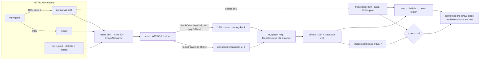

# Report notes: industrial visual anomaly detection on MVTec AD

MA6216 Final Project 3. PaDiM (baseline) vs PatchCore (main method) on bottle, capsule, screw, carpet, tile and leather, plus three PatchCore enhancements.

These notes follow the required presentation outline. Each `##` section is meant to become one to three slides. Every number is copied from a committed table. The source is given in square brackets:

| tag | file |
|---|---|
| [main] | `reports/tables/summary.md` and the per-metric tables beside it |
| [data] | `reports/dataset/dataset_stats.md` |
| [fail:x] | section `x` of `reports/figures/failure_cases/tables/failure_tables.md` (from `scripts/analysis_failures.py`) |
| [dino] | `reports/bonus/dinov2.md`, `reports/bonus/dinov2_tables/summary.md` |
| [ms] | `reports/bonus/multiscale.md`, `reports/bonus/multiscale_tables/summary.md` |
| [pp] | `reports/bonus/postproc.md`, `reports/bonus/postproc_tables/` |
| [lit] | `docs/literature_review.md` |

**Protocol reminder, which applies to every number below.** Models are fitted on 90% of `train/good`. All thresholds come from the remaining 10% normal-only validation split. Test labels and masks are used only for evaluation and for the post-hoc failure analysis in Section 6. `F1-max` is an **oracle** value that picks the threshold with test labels, so it is a reference only and never a result. All results are single-seed (seed 0).

---

## 1. Problem definition

A production line must reject parts with scratches, cracks, contamination, deformations or abnormal texture. Supervised defect classifiers fit this poorly. Defects are rare and expensive to label, especially with pixel masks. They are also open-ended, so the dangerous defect is the one never seen before. Defect-free parts, on the other hand, are plentiful. We therefore treat inspection as **one-class (unsupervised) anomaly detection**. A model sees only normal images and learns what "normal" looks like. At test time it outputs:

- an **image score**, which is thresholded into accept/reject (detection);
- a **pixel anomaly map**, which shows where the defect is (localisation, needed for operator trust and root-cause analysis).

MVTec AD formalises this setting: training sets contain only good images, and test sets mix good images with pixel-annotated defects. See [lit §1] for the full problem statement.

## 2. Dataset analysis

We use three **objects** and three **textures** [data, Overview / Defect size tables]:

| category | kind | fit / val (normal) | test good / defect | defect types | median defect area | align_corr |
|---|---|---|---|---|---|---|
| bottle | object | 188 / 21 | 20 / 63 | broken_large, broken_small, contamination | 5.72% | 0.996 |
| capsule | object | 197 / 22 | 23 / 109 | crack, faulty_imprint, poke, scratch, squeeze | 0.43% | 0.998 |
| screw | object | 288 / 32 | 41 / 119 | manipulated_front, scratch_head, scratch_neck, thread_side, thread_top | 0.29% | 0.579 |
| carpet | texture | 252 / 28 | 28 / 89 | color, cut, hole, metal_contamination, thread | 1.48% | 0.200 |
| tile | texture | 207 / 23 | 33 / 84 | crack, glue_strip, gray_stroke, oil, rough | 7.93% | 0.155 |
| leather | texture | 220 / 25 | 32 / 92 | color, cut, fold, glue, poke | 0.46% | 0.880 |

Key observations, all from [data]:

- **Defect size spans about three orders of magnitude.** It runs from 0.037% of the image (smallest capsule crack) to 35.49% (tile glue_strip). Screw, capsule and leather have median areas below 0.5%; tile and bottle are mostly above 2%. At a 224×224 input, one stride-8 WRN50 feature cell covers about 0.13% of the image, so many screw and capsule defects span only a few cells. Figure: `reports/dataset/defect_area_hist.png`.
- **Alignment.** Bottle and capsule are almost perfectly aligned (align_corr 0.996 and 0.998). Screw lies at arbitrary rotation and position (0.579). This is the property that breaks position-specific models. Figure: `reports/dataset/samples_screw.png`.
- **Texture vs object.** Textures are stationary: any patch can be compared with any normal patch, so alignment does not matter (for textures, align_corr reflects only illumination). Objects have a fixed background, so the decision rests on a small foreground area. Background specks and illumination gradients can create false alarms.
- **Normal variability** is highest for tile (pix_std 0.106) and screw (0.094). This broadens the learned normal distribution and makes threshold calibration harder. Section 5.3 shows that this matters for PaDiM.
- **Multiple regions.** Up to 10% of images per category contain several separate defect regions (screw thread_side averages 1.43 regions per image). AU-PRO weights every region equally.

## 3. Literature review and method selection

The full review is in [lit §2]. It covers reconstruction, feature-embedding (density estimation or memory bank), teacher–student distillation, normalising flows, synthetic-anomaly self-supervision, foundation and zero-shot models, and unified multi-class models.

We chose two **feature-embedding** methods that share one frozen ImageNet WideResNet-50-2 backbone but model normality in different ways [lit §3]:

| | PaDiM (baseline) | PatchCore (main) |
|---|---|---|
| Normality model | parametric: one Gaussian per spatial position | non-parametric: memory bank of normal patch features |
| Distance | Mahalanobis to the position's Gaussian | Euclidean to the nearest normal patch anywhere |
| Spatial assumption | position-specific (needs alignment) | position-agnostic |
| Training | single pass: means and covariances | single pass: features and coreset |

Reasons for this choice [lit §3.4]:
- strong published accuracy (PatchCore is near the top of full-shot MVTec AD);
- no back-propagation and few interpretable hyper-parameters, which makes failure analysis tractable;
- seconds to fit on one GPU;
- normal images only.

Using the same backbone isolates the modelling principle. The literature predicted that the gap would be largest on screw and capsule [lit §3.5], and Section 5 tests that.

## 4. Method principles and implementation

### 4.1 How the methods learn normal appearance

**PaDiM.** Each image passes through WRN50. `layer1` (56×56), `layer2` and `layer3` are upsampled to the 56×56 grid and concatenated (1,792 channels). A fixed random subset of d = 550 channels is kept. At every grid position (i, j), PaDiM fits a Gaussian over the N fit images: mean μᵢⱼ and covariance Σᵢⱼ + εI with ε = 0.01. A test feature's anomaly score is its Mahalanobis distance √((f − μᵢⱼ)ᵀ Σᵢⱼ⁻¹ (f − μᵢⱼ)). The image score is the maximum of the smoothed map. Note that N − 1 < d for every category (N = 188–288 fit images vs d = 550), so the sample covariance is rank-deficient and only ε regularises the directions that the training data do not span.

**PatchCore.** Features from `layer2` (28×28) and `layer3` are each averaged over a 3×3 neighbourhood, so each feature also summarises its local surroundings. `layer3` is upsampled to 28×28, and the two are concatenated and pooled to 1,024 dims. All patches of all fit images form a memory bank. A greedy k-centre **coreset** keeps 10% of it, selected in a 128-d random projection, so that the kept patches still cover all normal modes, including rare ones. A test patch's score is the distance to its nearest neighbour in the coreset. The image score uses PatchCore's **Eq. 7** reweighting. Take the most anomalous test patch m^test,* and its nearest bank patch m\*. Let 𝒩_b(m\*) be m\* plus its b − 1 nearest bank neighbours, with b = 9. Then

  s = (1 − exp‖m^test,* − m\*‖ / Σ_{m∈𝒩_b(m\*)} exp‖m^test,* − m‖) · ‖m^test,* − m\*‖,

implemented as 1 − softmax over the 9 support distances (`src/ad/patchcore.py`). The weight lowers the score of a patch whose nearest normal neighbour itself lies in a sparse, rare region of the bank.

### 4.2 Implementation details (shared pipeline)

- **Preprocessing:** resize to 256, centre crop to 224, then ImageNet mean/std normalisation. Masks get the same geometry, and all metrics are computed at 224×224 (`src/ad/data.py`).
- **Normal validation split:** 10% of `train/good` (21–32 images per category) is held out with a fixed seed (0) and never used for fitting.
- **Post-processing (`ad.scoring`):** raw feature-resolution maps are bilinearly upsampled to 224 and smoothed with a Gaussian of σ = 4 px (truncated at 4σ). Image score: PaDiM uses the max of the smoothed map; PatchCore uses Eq. 7 on the raw patch distances.
- **Thresholds (`ad.threshold`), from the normal val split only:** image threshold = 99% quantile of the val image scores; pixel threshold = 99.9% quantile of all val pixel scores.
- **Metrics (`ad.metrics`, the only consumer of test labels):** image AUROC; image F1/precision/recall at the val threshold; oracle F1-max; pixel AUROC; AU-PRO (per-region overlap integrated up to 30% FPR); pixel F1/IoU at the val pixel threshold, computed on anomalous test images.
- **Timing:** `infer_ms_per_image` covers model prediction plus upsampling/smoothing on preloaded batches with CUDA synchronisation. `infer_ms_per_image_e2e` adds data loading. Memory is peak allocated CUDA memory on an RTX 5080.

### 4.3 Pipeline



## 5. Experimental evaluation

### 5.1 Main results: PaDiM / PatchCore

Each cell is **PaDiM / PatchCore**. Source: [main] (`summary.md`, `fit_seconds.md`, `infer_ms_per_image*.md`, `peak_gpu_mem_gb.md`). Means are unweighted category means.

| category | image AUROC | image F1 (val thr) | F1-max (**oracle**) | pixel AUROC | AU-PRO | fit (s) | infer (ms/img) | infer e2e (ms/img) | peak GPU (GB) |
|---|---|---|---|---|---|---|---|---|---|
| bottle | 0.9992 / 1.0000 | 0.9767 / 1.0000 | 0.9921 / 1.0000 | 0.9816 / 0.9867 | 0.9486 / 0.9493 | 6.12 / 2.69 | 3.83 / 2.53 | 10.67 / 9.50 | 1.72 / 1.32 |
| capsule | 0.9023 / 0.9777 | 0.7869 / 0.8360 | 0.9686 / 0.9772 | 0.9850 / 0.9888 | 0.9144 / 0.9313 | 6.28 / 3.45 | 3.55 / 2.62 | 11.11 / 10.14 | 1.72 / 1.42 |
| screw | 0.8336 / 0.9705 | 0.2222 / 0.8837 | 0.9048 / 0.9633 | 0.9835 / 0.9932 | 0.9350 / 0.9627 | 6.07 / 4.62 | 3.38 / 3.21 | 8.66 / 8.48 | 1.72 / 1.83 |
| carpet | 0.9988 / 0.9872 | 0.9832 / 0.9355 | 0.9944 / 0.9770 | 0.9893 / 0.9898 | 0.9605 / 0.9503 | 6.50 / 4.34 | 3.59 / 2.93 | 10.97 / 10.24 | 1.72 / 1.61 |
| tile | 0.9812 / 0.9892 | 0.2857 / 0.8947 | 0.9634 / 0.9880 | 0.9386 / 0.9602 | 0.7990 / 0.8192 | 5.86 / 3.17 | 3.62 / 2.64 | 9.15 / 8.27 | 1.72 / 1.42 |
| leather | 1.0000 / 1.0000 | 0.9945 / 0.9634 | 1.0000 / 1.0000 | 0.9894 / 0.9930 | 0.9705 / 0.9722 | 6.06 / 3.51 | 3.54 / 2.76 | 10.01 / 9.24 | 1.72 / 1.42 |
| **mean (objects)** | 0.9117 / 0.9827 | 0.6620 / 0.9066 | 0.9552 / 0.9801 | 0.9834 / 0.9896 | 0.9327 / 0.9478 | 6.16 / 3.59 | 3.59 / 2.79 | 10.15 / 9.37 | 1.72 / 1.52 |
| **mean (textures)** | 0.9933 / 0.9921 | 0.7545 / 0.9312 | 0.9859 / 0.9883 | 0.9724 / 0.9810 | 0.9100 / 0.9139 | 6.14 / 3.67 | 3.58 / 2.78 | 10.04 / 9.25 | 1.72 / 1.48 |
| **mean (all)** | 0.9525 / 0.9874 | 0.7082 / 0.9189 | 0.9705 / 0.9842 | 0.9779 / 0.9853 | 0.9213 / 0.9308 | 6.15 / 3.63 | 3.58 / 2.78 | 10.10 / 9.31 | 1.72 / 1.50 |

Figures: `reports/figures/bar_image_auroc.png`, `bar_pixel_auroc.png`, `bar_aupro.png`. Per-category qualitative grids are in `reports/figures/qualitative/`.

**Headline.** PatchCore is better on every six-category mean and also cheaper: it fits about 1.7× faster and runs at 2.78 vs 3.58 ms/image with less GPU memory [main]. PaDiM's 1.72 GB peak GPU figure understates its real footprint. Its inverse covariances (56² × 550² × 4 B ≈ 3.8 GB per category [lit §3.4]) sit in pinned host RAM and are streamed to the GPU in chunks (`src/ad/padim.py`). PatchCore's coreset bank is only 57–88 MiB per category [ms, "Cost by scale", scale 1.0 rows].

### 5.2 Objects vs textures, and why PaDiM struggles on screw and capsule

- **Textures are a tie.** Mean texture image AUROC is 0.9933 (PaDiM) vs 0.9921 (PatchCore). PaDiM is even slightly better on carpet (0.9988 vs 0.9872) [main]. In a stationary texture every position sees the same statistics, so PaDiM's position-specific Gaussians lose nothing.
- **The gap is in the objects.** Mean object image AUROC is 0.9117 vs 0.9827, driven by **screw (0.8336 vs 0.9705)** and **capsule (0.9023 vs 0.9777)** [main]. This confirms the literature prediction [lit §3.5].
- **Screw: pose.** With align_corr 0.579 [data], a fixed grid position sees thread in one image, shank in another and background in a third. PaDiM's single Gaussian per position must therefore stretch to cover all of them, and a damaged thread becomes "within normal variation" at that position. PatchCore asks only whether the damaged patch resembles *any* normal patch *anywhere*, so pose does not matter. The failure analysis makes this concrete: PaDiM image recall on screw is 0.000–0.083 for four of five defect types, vs 0.522–0.960 for PatchCore [fail:recall_by_defect_type]. 80 of the 119 anomalous screw images are missed only by PaDiM [fail:miss_overlap]. Panel `01` shows an example.
- **Capsule: not pose.** Capsule is as well aligned as bottle (0.998 [data]), so pose does not explain its PaDiM deficit. The failure analysis points to **off-target responses**: 34.7% of PaDiM's capsule true positives have their map maximum *outside* the GT, vs 13.9% for PatchCore [fail:localisation]. The panels show PaDiM peaking on dust specks on the uniform background (panels `03`, `04`, `10`). Over a near-constant background the per-position covariance is tiny, so any speck becomes a large Mahalanobis outlier and can outscore a subtle defect on the capsule body. A second plausible factor, not isolated here, is few-pixel shifts at the sharp cap seam and imprint edges, which matter at PaDiM's stride-4 layer1 grid.
- **Pixel level: smaller gap.** Mean pixel AUROC is 0.9779 vs 0.9853 and AU-PRO 0.9213 vs 0.9308 [main]. Pixel AUROC is dominated by the many normal pixels and the large defects. Tile has the lowest AU-PRO for both methods (0.7990 / 0.8192), because its large, low-contrast oil and glue stains are segmented only partly.

### 5.3 PaDiM's F1 calibration problem

PaDiM ranks tile well (image AUROC 0.9812) and screw moderately (0.8336), yet its val-threshold F1 is **0.2857 on tile and 0.2222 on screw** [main]. The oracle F1-max values are 0.9634 and 0.9048. The val threshold is far too high:

| PaDiM | n_val | val median | val 2nd-largest | val max | image thr | thr / val median | test-anomaly median | precision | recall |
|---|---|---|---|---|---|---|---|---|---|
| screw | 32 | 17.60 | 25.45 | 26.47 | 26.15 | 1.49 | 23.02 | 0.938 | 0.126 |
| tile | 23 | 17.16 | 24.37 | 31.33 | 29.80 | 1.74 | 26.63 | 1.000 | 0.167 |

Source: [fail:calibration]. PatchCore's thr / val median is 1.20 on both screw and tile.

There are two causes:

1. **Inflated held-out distances.** With d = 550 and only 206–287 degrees of freedom (N − 1), each position's covariance is rank-deficient. The directions that the training images do not span are regularised only by ε = 0.01, so a *held-out* normal image with any energy in those directions gets a large Mahalanobis distance. This hits hardest where normal appearance varies most: tile and screw have the highest pix_std [data]. The result is a heavy right tail of val scores (PaDiM val_cv 0.154–0.194 on screw and tile, vs 0.068–0.072 for PatchCore [fail:calibration]). We infer this mechanism from the val distribution. We cannot measure it directly because in-sample training distances were not saved.
2. **The 99% quantile of about 23 scores is effectively the maximum.** `np.quantile` interpolates at position 0.99·(n − 1), i.e. between the two largest val scores. On tile, one normal val image (31.33) sits far above the second-largest (24.37) and alone sets the threshold at 29.80, above the *median anomalous test image* (26.63). On screw the problem is shared with ranking: even the second-largest val score (25.45) exceeds the test-anomaly median (23.02).

The cost is low recall (0.126 / 0.167) at near-perfect precision. Panel `07` shows a tile oil stain that PaDiM highlights at 1.55× its pixel threshold, yet the image score reaches only 0.98× its image threshold.

PatchCore suffers less, but it still loses calibration: its mean val-threshold F1 is 0.9189 vs an oracle of 0.9842 [main].

## 6. Failure-case analysis

All tables are produced by `scripts/analysis_failures.py` from the saved per-image outputs (`results/{padim,patchcore}_wrn50/<category>/`). Decisions use the stored **val** thresholds. Test labels are used only to describe the fixed predictions, and nothing was tuned on them.

**Totals.** Of 556 anomalous test images, PaDiM detects 343 and PatchCore 484. PaDiM flags 8 of 177 normal test images, PatchCore 19 [fail:per_image.csv, recall_by_defect_type].

### 6.1 Missed defects (FN) by defect type

Image recall at the val threshold, for the weakest types [fail:recall_by_defect_type]:

| category / defect | n | PaDiM | PatchCore |
|---|---|---|---|
| capsule / scratch | 23 | 0.348 | 0.435 |
| capsule / faulty_imprint | 22 | 0.455 | 0.682 |
| capsule / poke | 21 | 0.714 | 0.762 |
| screw / thread_side | 23 | 0.000 | 0.522 |
| screw / manipulated_front | 24 | 0.083 | 0.667 |
| screw / thread_top | 23 | 0.000 | 0.913 |
| screw / scratch_head | 24 | 0.083 | 0.917 |
| tile / gray_stroke | 16 | 0.062 | 0.375 |
| tile / rough | 15 | 0.067 | 0.600 |
| tile / oil, glue_strip, crack | 18, 18, 17 | 0.167, 0.167, 0.353 | 1.000, 1.000, 1.000 |

All bottle types and all leather types except PaDiM leather/color (0.947) reach 1.000 for both methods. Carpet is at least 0.941 for every type.

The hard defect types fall into three groups:
- **Tiny and thin:** capsule scratch and crack, screw thread_side.
- **Low-contrast and texture-consistent:** tile gray_stroke and rough. A grey stroke on grey tile looks like the tile's own dark blotches.
- **Semantic:** capsule faulty_imprint and screw manipulated_front. The patch looks locally plausible; the defect is a wrong *shape* of a legitimate structure.

**PatchCore FNs are mostly near-misses.** Their median image score is 0.94× the threshold, and 75% of them lie within 10% of it. In 83% of PatchCore's FNs, some pixel inside the GT exceeds the *pixel* threshold [computed from fail:per_image.csv]. The map does see these defects. They are lost at the *image* decision, because the image threshold is an extreme-value statistic: roughly the largest image score among about 25 normal val images. It is therefore stricter than the 99.9% pixel quantile. Panel `05` shows this: PatchCore segments a faulty imprint with IoU 0.45 but scores 0.83× its image threshold.

### 6.2 Missed defects by defect size

A GT region (8-connected, measured in the 224 crop) counts as detected if at least 30% of its pixels exceed the val pixel threshold (PRO-style). Sizes are in stride-8 feature cells; one cell is 64 px, or 0.128% of the crop [fail:region_detection_pooled]:

| region size | n regions | PaDiM | PatchCore |
|---|---|---|---|
| < 1 cell | 50 | 0.340 | 0.540 |
| 1–3 cells | 143 | 0.650 | 0.944 |
| 3–10 cells | 186 | 0.763 | 0.973 |
| 10–30 cells | 88 | 0.955 | 0.989 |
| 30–100 cells | 95 | 0.832 | 1.000 |
| ≥ 100 cells | 54 | 0.778 | 0.963 |

- **Sub-cell defects are the hard limit for PatchCore.** Only 54% of regions smaller than one feature cell are found, against at least 94% for every larger bin. These regions come mainly from capsule (15), screw (15) and tile (11) [fail:region_detection_by_category]. This matches the dataset analysis, where the smallest capsule crack is 0.037% of the image and the screw median is 0.29% [data]. The trend also holds at image level within the hard objects. PatchCore capsule recall rises from 0.629 (1–3 cells) to 0.705, 0.846 and 1.000 for larger defects; screw rises from 0.700 (1–3 cells) to 0.897 (3–10 cells) [fail:recall_by_image_area_capsule_screw]. The median GT area of PatchCore FNs is 0.39% of the crop, vs 0.94% for its TPs.
- **PaDiM's dip for large regions is calibration, not size.** PaDiM detects only 0.448 of the 30–100-cell tile regions [fail:region_detection_by_category]. These are large stains that it ranks well but thresholds badly (Section 5.3).
- **Preprocessing removes some defects.** Resize 256 followed by centre crop 224 discards a 12.5% border. Five anomalous images keep less than 50% of their GT, three of them tile gray_stroke [fail:crop_truncation]. Image recall on these five is 0.40 for PaDiM and 0.60 for PatchCore. Gray_stroke 012 keeps about 10% of its defect, and it and gray_stroke 002 are PatchCore's two lowest-scoring tile misses (panel `06`). On a real line the full field of view must be inspected.

### 6.3 False positives on normal images

| | PaDiM FP / normal | PatchCore FP / normal | PatchCore FP median predicted area |
|---|---|---|---|
| bottle | 3 / 20 | 0 / 20 | – |
| capsule | 2 / 23 | 1 / 23 | 0.008 |
| screw | 1 / 41 | 1 / 41 | 0.009 |
| carpet | 2 / 28 | **10 / 28** | **0.266** |
| tile | 0 / 33 | 0 / 33 | – |
| leather | 0 / 32 | **7 / 32** | 0.072 |

Source: [fail:false_positives]. The predicted area is the fraction of pixels above the pixel threshold.

What triggers them:
- **PatchCore texture FPs are global, not local.** On the flagged normal carpets a median 26.6% of the image exceeds the pixel threshold, with no hotspot (panel `08`). Normal *test* images score systematically higher than the normal *val* images, which come from `train/good`. On carpet the PatchCore median is 1.112 (test good) vs 1.061 (val); on leather it is 1.070 vs 0.968. The val spread is also the tightest of all categories there (val_cv 0.037 and 0.048) [fail:calibration]. A 99% val quantile therefore leaves almost no margin for this shift between the train and test normals, which likely comes from acquisition or material lot. PaDiM sees a similar shift on leather (13.11 vs 11.73), but its looser threshold (1.58× the val median) absorbs it (panel `09`).
- **PaDiM FPs are local and come from rare but harmless appearances.** Its flagged images have only 0.4–2.1% of pixels above the pixel threshold [fail:false_positives]. The triggers are a dust speck on the capsule background (panel `10`), a dark mark in the corner of capsule good/021 (flagged by both methods, with the peak at the corner pixel), and a small bright spot on the glossy bottle rim (panel `11`). The bottle rim was anticipated in [data], and 3 of 20 normal bottles are flagged by PaDiM.
- **Borders.** All of PaDiM's carpet and screw FPs, and the shared capsule good/021 FP, peak within 16 px of the crop edge. That band is 27% of the image area [fail:false_positives]. Padding effects at the image border are a recurring trigger.

### 6.4 True positives with poor localisation

| | median TP pixel IoU (PaDiM / PatchCore) | TPs with IoU < 0.1 | TPs with peak outside GT |
|---|---|---|---|
| bottle | 0.538 / 0.442 | 0.000 / 0.016 | 0.079 / 0.016 |
| capsule | 0.219 / 0.206 | 0.181 / 0.139 | **0.347** / 0.139 |
| screw | 0.305 / 0.192 | 0.067 / 0.137 | 0.267 / 0.179 |
| carpet | 0.200 / 0.162 | 0.239 / 0.345 | 0.136 / 0.080 |
| tile | 0.234 / 0.574 | 0.071 / 0.132 | 0.143 / 0.074 |
| leather | **0.048 / 0.039** | **0.747 / 0.815** | 0.198 / 0.065 |

Source: [fail:localisation].

- **Leather is detected perfectly but segmented poorly.** 75% (PaDiM) and 82% (PatchCore) of its TPs have IoU < 0.1. The defects are tiny (median 0.46% [data]), and the stride-8 grid, bilinear upsampling and σ = 4 blur together turn a thin streak into a blob several times wider (panel `12`, IoU 0.07 for both methods). This does not show in AU-PRO (0.97 for both [main]), which is threshold-free and credits partial overlap. Pixel IoU at a fixed threshold is the stricter, deployment-relevant view.
- **Right decision, wrong place.** For a third of PaDiM's capsule TPs, the map maximum lies outside the defect. The image is flagged for the wrong reason (Section 5.2).

### 6.5 Which failures are shared and which are PaDiM-only

[fail:miss_overlap], over 556 anomalous images:

| | capsule | screw | tile | carpet | leather | total |
|---|---|---|---|---|---|---|
| missed by **both** | 20 | 24 | 16 | 1 | 0 | **61** |
| missed **only by PaDiM** | 17 | 80 | 54 | 0 | 1 | **152** |
| missed **only by PatchCore** | 10 | 0 | 0 | 1 | 0 | **11** |

- **PaDiM-only misses** come from two separate mechanisms. On **screw** it is pose (80 images); on **tile** it is calibration (54 images, even though tile image AUROC is 0.9812).
- **Shared misses** mark the limits of frozen WRN50 features at 224 px. They are concentrated in screw thread_side (11) and manipulated_front (8), capsule scratch (9) and faulty_imprint (5), and tile gray_stroke (10) and rough (6). These are the tiny, thin, low-contrast and semantic types from Section 6.1, plus the crop-truncated tile images.
- **PatchCore-only misses** are few and all near-threshold capsule cases (crack 2, faulty_imprint 2, poke 2, scratch 4).

### 6.6 Curated panels (`reports/figures/failure_cases/`)

Each panel shows the image with the GT outline in green, then the PaDiM map and the PatchCore map. Maps are scaled to each method's val pixel threshold (1.0 = threshold), and red outlines mark the predicted region. Fuller captions are in `reports/figures/failure_cases/README.md`.

1. `01_screw_thread_top_004.png`: **missed only by PaDiM (pose).** PaDiM's map stays below threshold everywhere. PatchCore flags the damaged tip (IoU 0.45).
2. `02_screw_thread_side_004.png`: **missed by both.** Two tiny regions on the thread flank (0.14% of the image). Thread is normal high-frequency structure, so neither map rises above threshold inside the GT.
3. `03_capsule_scratch_017.png`: **missed by both.** A faint scratch at the seam. PatchCore's map is flat (max 0.87× its pixel threshold). PaDiM's only hot spot is background dust.
4. `04_capsule_crack_016.png`: **missed by both, peak off-target.** Both maps peak on dark specks on the cap and the background, and the thin crack stays below threshold.
5. `05_capsule_faulty_imprint_019.png`: **localised but not detected (PatchCore).** Above the pixel threshold on the faulty "5", but the image score is only 0.83× the image threshold.
6. `06_tile_gray_stroke_012.png`: **removed by preprocessing.** About 10% of the GT survives the centre crop, and the rest of the stroke is outside the evaluated image.
7. `07_tile_oil_000.png`: **PaDiM calibration failure.** The stain is clearly highlighted (1.55× pixel threshold), but the image threshold set by one extreme val image is not reached. PatchCore gets IoU 0.85.
8. `08_carpet_good_012.png`: **global-shift FP.** 42% of PatchCore's pixels exceed its threshold on a normal carpet, with no local cause.
9. `09_leather_good_024.png`: **PatchCore texture FP.** Diffuse elevation with blobs at the left border. PaDiM's looser threshold absorbs it.
10. `10_capsule_good_006.png`: **PaDiM-only FP from background dust.** The tight per-position background Gaussian turns a speck into a 1.23× threshold score.
11. `11_bottle_good_015.png`: **PaDiM-only FP on the glossy rim.**
12. `12_leather_color_009.png`: **TP with poor localisation.** The thin streak becomes a broad blob, giving IoU 0.07 for both methods.

## 7. Bonus: PatchCore enhancements

Three bonus experiments changed one factor each relative to PatchCore-WRN50. All variants were specified **a priori** except one DINOv2 run, which is labelled **post-hoc**. Values are six-category means.

| variant | kind | image AUROC | image F1 (val) | pixel AUROC | AU-PRO | infer ms/img | peak GiB | source |
|---|---|---|---|---|---|---|---|---|
| **PatchCore WRN50 baseline** (Eq. 7) | – | 0.9874 | 0.9189 | 0.9853 | 0.9308 | 2.78 | 1.50 | [main] |
| DINOv2 ViT-B/14 | a priori | 0.9749 | 0.9145 | 0.9862 | 0.9314 | 12.91 | 3.33 | [dino] |
| DINOv2 ViT-S/14 | a priori | 0.9678 | 0.9281 | 0.9860 | 0.9290 | 6.33 | 2.22 | [dino] |
| WRN50 + DINOv2-B | a priori | 0.9646 | 0.9061 | 0.9828 | 0.9141 | 13.77 | 3.08 | [dino] |
| DINOv2-B without final LayerNorm | **post-hoc, test-informed, not selectable** | 0.9863 | 0.9052 | 0.9773 | 0.9077 | 12.88 | 3.33 | [dino] |
| multiscale layers 1+2+3 | a priori | 0.9866 | 0.8984 | 0.9873 | **0.9454** | 25.87 | 5.55 | [ms] |
| multiscale layers 2+3+4 | a priori | 0.9221 | 0.8119 | 0.9334 | 0.7058 | 3.25 | 1.67 | [ms] |
| max-score control (same model, smoothed-map max) | a priori | 0.9883 | 0.9341 | 0.9853 | 0.9308 | 2.79 | 1.50 | [ms] |
| input pyramid 1.0 + 1.5, mean (vs max control) | a priori | **0.9903** | **0.9429** | 0.9867 | 0.9400 | 12.81 | 3.45 | [ms] |
| input pyramid, z-mean | a priori | 0.9903 | 0.9429 | 0.9867 | 0.9399 | 12.82 | 3.45 | [ms] |
| post-proc: top-1% mean image score | a priori | 0.9878 | 0.9347 | 0.9853 | 0.9308 | 2.79 | 1.50 | [pp] |
| post-proc: smoothed-map max | a priori | 0.9883 | 0.9341 | 0.9853 | 0.9308 | 2.79 | 1.50 | [pp] |
| post-proc: σ = 0 / 2 / 8 (vs σ = 4) | a priori | 0.9874 | 0.9189 | 0.9851 / 0.9852 / 0.9848 | 0.9324 / 0.9322 / 0.9233 | 2.75 / 2.78 / 2.81 | 1.50 | [pp] |
| post-proc: **one global threshold** (z = 3 / pooled val 99%) | a priori | 0.9874 | **0.8898 / 0.8685** | 0.9853 | 0.9308 | 2.79 | 1.50 | [pp] |

Notes:
- Each bonus report re-measured the baseline's timing (fit 3.63–3.64 s, inference 2.78–2.79 ms) [dino, ms, pp].
- The post-processing timings replay cached predictions, so they are controlled estimates rather than independent runs [pp].
- Compare the pyramid against the max-score control, because the pyramid also uses max scoring rather than Eq. 7 [ms].

### 7.1 What helped

- **Adding layer1 improves localisation at an image-level cost.** AU-PRO rises from 0.9308 to 0.9454 (+0.0146), and every category gains AU-PRO, for example screw +0.0194 and tile +0.0253 [ms]. Image F1 drops from 0.9189 to 0.8984, and capsule image AUROC from 0.978 to 0.955. Cost: 9.3× inference time and 5.55 vs 1.50 GiB [ms]. This fits Section 6: finer stride-4 features help the sub-cell and boundary failures, but more low-level evidence also creates more normal-but-rare peaks for the image decision.
- **The input pyramid gives small gains everywhere.** Against the max control: image AUROC +0.0021, AU-PRO +0.0092, image F1 0.9341 → 0.9429, at 4.6× the inference time [ms]. The gains are not concentrated in the smallest-defect categories [ms]. z-mean is effectively the same as mean, because the per-scale standard deviation ratio is close to 1 [ms].
- **The image-score aggregation choice changes calibration, not ranking.** Smoothed-map max or top-1% mean raise mean F1 by about 1.5 points (0.9189 → 0.9341 / 0.9347) while AUROC barely moves [pp]. The effect varies by category: top-1% helps capsule (0.8360 → 0.9216) and tile (0.8947 → 0.9818) but hurts screw (0.8837 → 0.8293) [pp].

### 7.2 What did not help

- **DINOv2, under our protocol.** All three a-priori variants lower mean image AUROC (0.9749 / 0.9678 / 0.9646 vs 0.9874), driven by **screw** (0.9705 → 0.8791 / 0.8223 / 0.8094) [dino]. Textures do improve (mean texture F1 0.9312 → 0.9868 / 0.9925 / 0.9904; texture AU-PRO 0.9139 → 0.9452 / 0.9446 / 0.9405). Inference costs 2.3–4.9× more [dino].
  - *Why:* a post-hoc screw diagnostic [dino] traced the regression mostly to **processing**, not to self-supervised features as such. Applying DINOv2's *final* LayerNorm to intermediate blocks puts 41% and 39% of token variance into just 5 of 768 channels. Those few channels then dominate Euclidean nearest-neighbour distances. The CNN-tuned 3×3 patch aggregation also contributes: patch size 1 alone recovers screw image AUROC to 0.9367.
  - *Post-hoc caveat:* the full six-category no-LayerNorm run was **chosen after looking at test results**. It recovers mean image AUROC to 0.9863 but lowers texture AU-PRO (0.9452 → 0.8962). It is reported as a sensitivity check, not as a result we could select.
- **Adding layer4** hurts badly: AU-PRO 0.7058, screw image AUROC 0.6653 [ms]. Coarse 7×7 semantics dilute fine defect evidence.

### 7.3 Deployment-relevant findings

- **One threshold for all products costs about 3 F1 points.** A fixed z = 3 cutoff on val-normalised scores drops mean F1 from 0.9189 to 0.8898, and a pooled-val 99% cutoff to 0.8685 [pp]. Capsule recall falls to 0.5505 at z = 3 [pp, global_thresholds.md]. Per-product calibration is still needed.
- **Smoothing with σ ≤ 4 does not matter.** σ = 0, 2 and 4 differ by at most 0.0016 in AU-PRO and about 2×10⁻⁴ in pixel AUROC. σ = 8 lowers AU-PRO in all six categories (macro −0.0075) [pp]. We would keep σ = 4 or drop smoothing; neither choice is critical.

## 8. Conclusions

**Advantages (PatchCore, shown here on six categories):**
- **No training.** One forward pass plus coreset selection: 3.63 s mean fit per category from about 200 normal images [main].
- **Fast and light.** 2.78 ms/image of GPU compute, 9.31 ms/image end-to-end including loading, 1.50 GB peak GPU memory, and a 57–88 MiB memory bank [main; ms].
- **Accurate.** Mean image AUROC 0.9874, pixel AUROC 0.9853, AU-PRO 0.9308 [main].
- **Robust to pose.** Screw image AUROC 0.9705 vs 0.8336 for PaDiM [main].
- **Explainable.** Every anomalous patch has a nearest normal patch that can be shown to an operator.

**Advantages (PaDiM):**
- Equally good on stationary textures (texture image AUROC 0.9933 [main]) with a very simple statistical model.

**Limitations seen in our results:**
- **Threshold calibration with few normal images is the largest practical weakness.** With 21–32 val images, the 99% quantile is close to the val maximum.
  - PaDiM's F1 collapses on tile and screw (0.2857 / 0.2222) despite usable rankings.
  - PatchCore loses 6.5 F1 points against the oracle (0.9189 vs 0.9842; the oracle is only a reference) [main].
  - 75% of PatchCore's misses are within 10% of the threshold [fail].
- **Normal drift.** Normal test carpets and leathers score higher than the normal val images. This produces 10 of 28 and 7 of 32 PatchCore false alarms [fail:false_positives, calibration]. A model fitted on one batch of normal images may not transfer to the next.
- **Small and subtle defects.** Regions smaller than one stride-8 feature cell are detected only 54% of the time by PatchCore [fail:region_detection_pooled]. Thin scratches and cracks, low-contrast tile strokes and semantic imprint errors make up most of the 61 images both methods miss [fail:miss_overlap].
- **Localisation precision.** Small defects become smoothed blobs (leather median TP IoU 0.039 for PatchCore [fail:localisation]), although AU-PRO looks high.
- **Preprocessing.** The centre crop discards the image border, which can remove part or all of a defect [fail:crop_truncation].
- **One model per product.** Every category needs its own memory bank and threshold, and a single global threshold costs about 3 F1 points [pp].
- **PaDiM specifically** needs aligned parts and stores about 3.8 GB of inverse covariances per category [lit §3.4]. It also reacts strongly to specks on uniform backgrounds.
- **Evidence limits.** Single seed, no confidence intervals, six of 15 MVTec categories, 224 px input.

**Industrial applicability.** PatchCore suits a line that can supply a few hundred good images per product and can tolerate per-product setup. Setup takes seconds and inference is millisecond-scale on one GPU. Before deployment we would need:
- a larger normal calibration set, with the operating point chosen by the cost of a miss vs a false alarm rather than a fixed 99% quantile;
- full field-of-view inspection, with no centre crop;
- higher resolution or tiling for sub-0.3%-area defects;
- drift monitoring of normal score levels, with memory-bank refresh when the material lot or lighting changes.

Near-threshold images (about ±10%) are natural candidates for human review.

**Next steps:**
1. **Resolution.** Fix a native higher-resolution protocol a priori. A post-hoc 448 px screw diagnostic in [dino] gave WRN50 image AUROC 0.9836 vs 0.9705. It is test-informed, so it needs confirmation with a protocol fixed in advance.
2. **Decouple localisation from detection.** Use layer1-augmented maps for segmentation but keep layer2+3 with Eq. 7 for the accept/reject score. This targets the trade-off in Section 7.1.
3. **Calibration.** Larger val splits, per-category score normalisation with a margin, and checks for train-vs-test normal shift.
4. **DINOv2 re-test.** Re-evaluate DINOv2 with no final LayerNorm and patch size 1 fixed a priori, on categories not used in the diagnosis.
5. **Rotation coverage for pose-variable parts.** Add rotated normal images to the memory bank for parts like screw.
6. **Statistics.** Multiple seeds and bootstrap confidence intervals.

---

### Reproducing the failure analysis

```bash
PY=/home/eva/code/ma6216/industrial-visual-anomaly-detection/.venv/bin/python
export PYTHONPATH=src MVTEC_ROOT=/home/eva/code/ma6216/industrial-visual-anomaly-detection/data/mvtec_ad
$PY scripts/analysis_failures.py          # tables -> reports/figures/failure_cases/tables/
$PY scripts/analysis_failure_panels.py    # panels + README -> reports/figures/failure_cases/
```

Both scripts only read the existing `results/padim_wrn50` and `results/patchcore_wrn50` outputs on the CPU. They neither fit models nor change thresholds.
