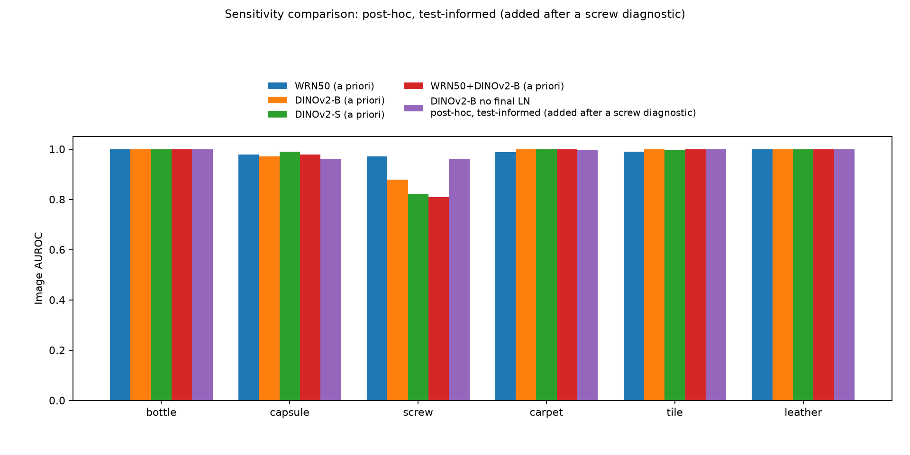
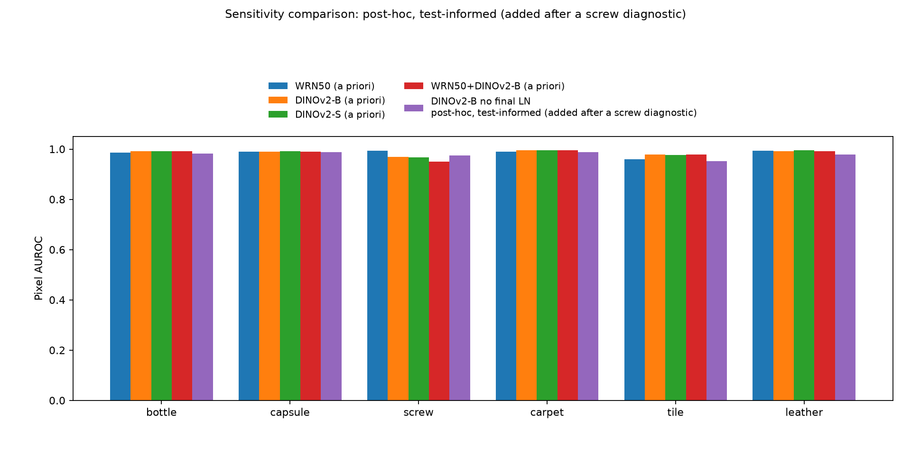
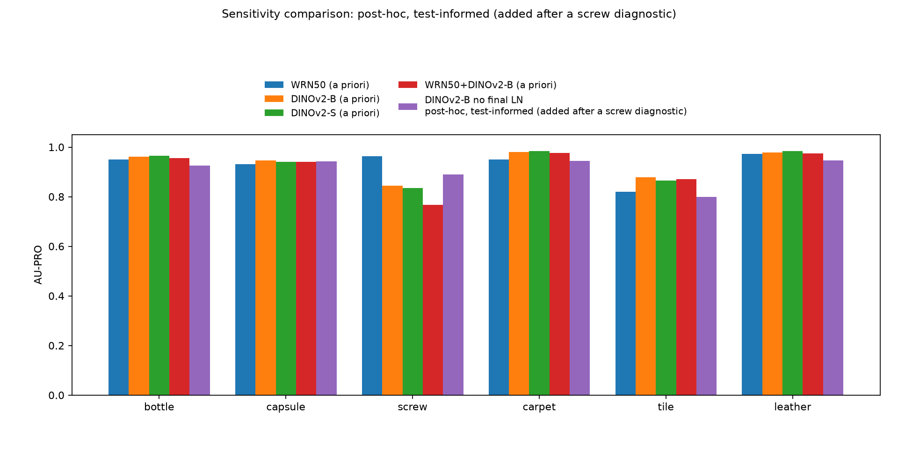

# DINOv2 features for PatchCore

This experiment replaces the frozen feature extractor in the WRN50 PatchCore baseline with self-supervised DINOv2 features. The three headline variants were fixed before evaluation and are evaluated on bottle, capsule, screw, carpet, tile, and leather; their committed results and tables remain the headline, unchanged. The additional `patchcore_dinov2_vitb14_noln` run is **post-hoc, test-informed (added after a screw diagnostic)** and is reported separately below; it does not replace a headline model and is not used for selection.

## Protocol

| Run | Features returned to PatchCore | Feature grid | Channels per returned map |
| --- | --- | --- | --- |
| `patchcore_wrn50` | ImageNet WRN50 layer2, layer3 | 28×28, 14×14; PatchCore aligns to 28×28 | 512, 1024 |
| `patchcore_dinov2_vitb14` | DINOv2 ViT-B/14 blocks 5, 8, 11 (zero-indexed) | 32×32 | 768, 768, 768 |
| `patchcore_dinov2_vits14` | DINOv2 ViT-S/14 blocks 5, 8, 11 (zero-indexed) | 32×32 | 384, 384, 384 |
| `patchcore_wrn50_dinov2` | WRN50 layer2+3 followed by DINOv2 ViT-B/14 blocks 5, 8, 11 | all bilinearly aligned to 28×28 inside backbone | 512, 1024, 768, 768, 768 |

Each YAML changes only the feature-backbone configuration relative to `patchcore_wrn50.yaml`. The smaller model probes capacity within the DINOv2 feature-extractor factor, and the combined variant probes combining semantic and convolutional features. The default input pipeline remains resize 256 → center crop 224 → ImageNet normalization; DINOv2 alone bilinearly upsamples that normalized crop to 448 inside its forward pass. For the headline runs, all selected intermediate DINOv2 tokens receive the same final LayerNorm (`norm=True`, still the API default), and timm removes the CLS token and any register tokens before returning spatial maps. The new `norm` keyword can bypass that final learned LayerNorm while retaining the transformer blocks' internal normalization; `dinov2_vitb14_raw` fixes `norm=False` for the separate **post-hoc, test-informed (added after a screw diagnostic)** run. The combined backbone keeps WRN50's original 224 input and returns five separate maps to the unchanged PatchCore per-layer MeanMapper and Aggregator, without feature reweighting.

Patch size **3**, target dimension **1024**, coreset ratio **0.1**, projection dimension **128**, neighbor count **9**, Gaussian sigma **4**, seed **0**, and the default batch size **32** are unchanged. Training uses the complete 90% normal train split; the held-out 10% normal validation split determines thresholds at image quantile 0.99 and pixel quantile 0.999. Evaluation maps stay at **224×224**. `image_f1` uses the validation threshold; any `image_f1_max_oracle` in the aggregate files is an **oracle reference**, not a model-selection criterion. Model fitting and prediction consume only `batch["image"]`.

The DINOv2 grid has 1024 positions per image versus 784 for the baseline, increasing the training candidate count and 10% memory-bank size by approximately 30.6%; the 28×28 combined grid was fixed a priori to retain the baseline patch count. The combined backbone resamples WRN50 layer3 before PatchCore unfolds patches, whereas baseline PatchCore unfolds it at 14×14 before alignment, so the backbone experiment also changes this branch's spatial sampling. No changes to PatchCore, preprocessing, scoring, threshold selection, or metrics are required.

## Reproduction

Use the shared virtual environment, offline cached pretrained weights, and GPU serialization:

```bash
export HF_HUB_OFFLINE=1
export MVTEC_ROOT=/home/eva/code/ma6216/industrial-visual-anomaly-detection/data/mvtec_ad
export PYTHONPATH=src
for run in patchcore_wrn50 patchcore_dinov2_vitb14 patchcore_dinov2_vits14 patchcore_wrn50_dinov2
do
  scripts/gpu_run.sh /home/eva/code/ma6216/industrial-visual-anomaly-detection/.venv/bin/python \
    -m ad.run --config "configs/${run}.yaml" --no-figs
done
# post-hoc, test-informed (added after a screw diagnostic); not used for selection
scripts/gpu_run.sh /home/eva/code/ma6216/industrial-visual-anomaly-detection/.venv/bin/python \
  -m ad.run --config configs/patchcore_dinov2_vitb14_noln.yaml --no-figs
# Regenerate the separate headline and sensitivity tables/figures from existing results.
/home/eva/code/ma6216/industrial-visual-anomaly-detection/.venv/bin/python \
  reports/bonus/dinov2_aggregate.py
```

Inference timing includes model prediction (feature extraction, memory-bank search, and image-score weighting) and map upsampling/smoothing, with CUDA synchronization and preloaded test batches; it excludes disk loading and metrics. `fit_seconds` includes feature extraction and coreset selection, and `peak_gpu_mem_gb` measures peak allocated CUDA memory over model creation, fitting, validation, and inference, not total device occupancy. The aggregate also retains a separate end-to-end inference timing including test loading. Runs used the shared RTX 5080 (16 GB), Python 3.12.3, torch 2.11.0+cu128 (CUDA runtime 12.8), and timm 1.0.31, in float32 without autocast.

## Resolution check

The 448 input is still interpolated from a 224 crop and does not add source-image information, but this does **not** explain the observed screw regression. The review checked a native resize-512/crop-448/evaluate-448 protocol: DINOv2 screw image AUROC was **0.8834** versus **0.8791** for the committed upsampled crop, while WRN50 improved from **0.9705** to **0.9836**. That diagnostic does not change the DINOv2 conclusion; it is included only in the diagnostic table below, not as an additional variant, and its 448-pixel localization metrics are not comparable to the headline 224-pixel metrics. Architecture, pretraining, feature depths, and native feature grids still differ within the backbone factor, so the headline comparison does not isolate a causal effect of self-supervision.

The coordinator approved the topic-specific `dinov2_figures` directory to avoid filename collisions between bonus experiments. The reproducible [aggregation helper](dinov2_aggregate.py) calls the existing `ad.aggregate` entry point for the original four runs and for all five runs, preserves each four-run headline table and chart, and appends separately labelled sensitivity tables and `posthoc_bar_*.png` charts for the **post-hoc, test-informed (added after a screw diagnostic)** run. The CSV also labels this run explicitly; numeric strings and all original run values are retained. Tables and the per-run summary remain in `dinov2_tables`.

## Verification

The complete repository suite, including GPU and data-marked tests, ran with the shared GPU lock and real cached weights:

```bash
HF_HUB_OFFLINE=1 \
MVTEC_ROOT=/home/eva/code/ma6216/industrial-visual-anomaly-detection/data/mvtec_ad \
scripts/gpu_run.sh /home/eva/code/ma6216/industrial-visual-anomaly-detection/.venv/bin/python -m pytest -q
```

```text
........................................................................ [ 54%]
.............................................................            [100%]
133 passed in 22.40s
```

The new tests cover registered backbone names, unchanged experiment settings, both DINOv2 model sizes at 448, block ordering and normalized spatial-token values with CLS exclusion, exclusion of all four register tokens plus CLS in a register-equipped ViT, combined-grid channels and exact agreement of its WRN branch with standalone WRN50 maps resampled to 28×28, both values of the normalization keyword, its propagation through the combined model, the raw registered name, and PatchCore fit/predict on 20 normal bottle training images with 10 test images. The register-equipped test uses random weights to avoid requiring an additional checkpoint; both experiment model sizes and the combined backbone use the cached pretrained weights. Implementation commit: `628dd9c` (`feat(backbones): add frozen DINOv2 PatchCore feature variants`), on branch `exp/dinov2`; normalization revision: `ce51386` (`fix(dinov2): expose final normalization for sensitivity analysis`).

## Headline results (a priori, unchanged)

All metrics use the complete test split for each category; means are unweighted category means (three objects, three textures, six overall). AUROC, F1, and AU-PRO are fractions; fit time is seconds, inference is milliseconds per image, and memory is GiB (1024³ bytes). Runtime includes the unchanged 10% memory bank, so these measurements compare complete PatchCore systems rather than isolated backbone forwards.

| Category/group | Backbone | Image AUROC | Image F1 | Pixel AUROC | AU-PRO | Fit (s) | Infer (ms/image) | Peak GPU (GiB) |
| --- | --- | ---: | ---: | ---: | ---: | ---: | ---: | ---: |
| bottle | WRN50 | 1.0000 | 1.0000 | 0.9867 | 0.9493 | 2.69 | 2.53 | 1.32 |
| bottle | DINOv2-B | 1.0000 | 0.9921 | 0.9915 | 0.9620 | 5.20 | 12.47 | 3.14 |
| bottle | DINOv2-S | 1.0000 | 1.0000 | 0.9920 | 0.9650 | 3.97 | 5.91 | 2.03 |
| bottle | WRN50+DINOv2-B | 1.0000 | 1.0000 | 0.9906 | 0.9557 | 4.61 | 13.49 | 2.94 |
| capsule | WRN50 | 0.9777 | 0.8360 | 0.9888 | 0.9313 | 3.45 | 2.64 | 1.42 |
| capsule | DINOv2-B | 0.9713 | 0.8601 | 0.9905 | 0.9454 | 5.66 | 12.54 | 3.27 |
| capsule | DINOv2-S | 0.9900 | 0.8526 | 0.9906 | 0.9398 | 4.66 | 5.97 | 2.15 |
| capsule | WRN50+DINOv2-B | 0.9793 | 0.8022 | 0.9901 | 0.9400 | 4.99 | 13.61 | 3.03 |
| screw | WRN50 | 0.9705 | 0.8837 | 0.9932 | 0.9627 | 4.63 | 3.22 | 1.83 |
| screw | DINOv2-B | 0.8791 | 0.6740 | 0.9688 | 0.8452 | 9.05 | 13.63 | 3.64 |
| screw | DINOv2-S | 0.8223 | 0.7385 | 0.9670 | 0.8356 | 7.15 | 7.05 | 2.53 |
| screw | WRN50+DINOv2-B | 0.8094 | 0.6630 | 0.9510 | 0.7677 | 7.40 | 14.20 | 3.32 |
| carpet | WRN50 | 0.9872 | 0.9355 | 0.9898 | 0.9503 | 4.37 | 2.94 | 1.61 |
| carpet | DINOv2-B | 0.9996 | 0.9780 | 0.9956 | 0.9801 | 7.81 | 13.23 | 3.39 |
| carpet | DINOv2-S | 0.9996 | 0.9834 | 0.9962 | 0.9840 | 6.38 | 6.63 | 2.28 |
| carpet | WRN50+DINOv2-B | 1.0000 | 0.9889 | 0.9952 | 0.9765 | 6.57 | 13.93 | 3.13 |
| tile | WRN50 | 0.9892 | 0.8947 | 0.9602 | 0.8192 | 3.16 | 2.65 | 1.42 |
| tile | DINOv2-B | 0.9993 | 0.9825 | 0.9786 | 0.8782 | 5.80 | 12.74 | 3.27 |
| tile | DINOv2-S | 0.9949 | 0.9940 | 0.9756 | 0.8654 | 4.49 | 6.14 | 2.15 |
| tile | WRN50+DINOv2-B | 0.9989 | 0.9822 | 0.9784 | 0.8701 | 5.04 | 13.63 | 3.03 |
| leather | WRN50 | 1.0000 | 0.9634 | 0.9930 | 0.9722 | 3.52 | 2.77 | 1.42 |
| leather | DINOv2-B | 1.0000 | 1.0000 | 0.9923 | 0.9775 | 6.37 | 12.86 | 3.27 |
| leather | DINOv2-S | 1.0000 | 1.0000 | 0.9947 | 0.9843 | 5.07 | 6.27 | 2.15 |
| leather | WRN50+DINOv2-B | 1.0000 | 1.0000 | 0.9916 | 0.9749 | 5.46 | 13.75 | 3.03 |
| mean (objects) | WRN50 | 0.9827 | 0.9066 | 0.9896 | 0.9478 | 3.59 | 2.80 | 1.52 |
| mean (objects) | DINOv2-B | 0.9501 | 0.8421 | 0.9836 | 0.9175 | 6.64 | 12.88 | 3.35 |
| mean (objects) | DINOv2-S | 0.9374 | 0.8637 | 0.9832 | 0.9135 | 5.26 | 6.31 | 2.24 |
| mean (objects) | WRN50+DINOv2-B | 0.9295 | 0.8217 | 0.9773 | 0.8878 | 5.67 | 13.77 | 3.10 |
| mean (textures) | WRN50 | 0.9921 | 0.9312 | 0.9810 | 0.9139 | 3.68 | 2.79 | 1.48 |
| mean (textures) | DINOv2-B | 0.9996 | 0.9868 | 0.9888 | 0.9452 | 6.66 | 12.94 | 3.31 |
| mean (textures) | DINOv2-S | 0.9982 | 0.9925 | 0.9888 | 0.9446 | 5.31 | 6.34 | 2.19 |
| mean (textures) | WRN50+DINOv2-B | 0.9996 | 0.9904 | 0.9884 | 0.9405 | 5.69 | 13.77 | 3.06 |
| mean (all) | WRN50 | 0.9874 | 0.9189 | 0.9853 | 0.9308 | 3.64 | 2.79 | 1.50 |
| mean (all) | DINOv2-B | 0.9749 | 0.9145 | 0.9862 | 0.9314 | 6.65 | 12.91 | 3.33 |
| mean (all) | DINOv2-S | 0.9678 | 0.9281 | 0.9860 | 0.9290 | 5.29 | 6.33 | 2.22 |
| mean (all) | WRN50+DINOv2-B | 0.9646 | 0.9061 | 0.9828 | 0.9141 | 5.68 | 13.77 | 3.08 |

The complete aggregate output, including per-category tables for every metric and the explicitly labelled oracle F1 reference, is in [dinov2_tables/summary.md](dinov2_tables/summary.md). Performance tables retain four-decimal precision in that directory. The aggregate charts are in [dinov2_figures](dinov2_figures).

## Analysis

On the three object categories, mean image AUROC falls from **0.9827** (WRN50) to **0.9501** (ViT-B), **0.9374** (ViT-S), and **0.9295** (combined), so these features do not deliver a general improvement on the hard objects under this protocol. Screw drives the regression: its image AUROC changes from **0.9705** to **0.8791 / 0.8223 / 0.8094**, and AU-PRO changes from **0.9627** to **0.8452 / 0.8356 / 0.7677**, in B / S / combined order. Capsule is mixed: ViT-S improves image AUROC from **0.9777** to **0.9900**, ViT-B decreases it to **0.9713**, and all three improve localization AU-PRO from **0.9313** to **0.9454 / 0.9398 / 0.9400**. Textures benefit more consistently, with mean image F1 improving from **0.9312** to **0.9868 / 0.9925 / 0.9904** and mean AU-PRO from **0.9139** to **0.9452 / 0.9446 / 0.9405**, largely through carpet and tile while every model already reaches leather image AUROC **1.0000**. Across all six categories, ViT-B's mean AU-PRO is nearly unchanged (**0.9314** versus **0.9308**), ViT-S has higher validation-threshold image F1 (**0.9281** versus **0.9189**), and every variant has lower mean image AUROC, illustrating that ranking and threshold transfer measure different behavior.

The screw diagnostics below show that the headline regression is mostly a processing artifact: applying the last-block LayerNorm to intermediate blocks concentrates channel variance, and the inherited CNN-style 3×3 aggregation also contributes. Upsampling, target dimension, and the tested alternative block choice were ruled out as the main explanations by the review's controls. In the combined backbone, **unweighted fusion of LayerNorm-amplified DINOv2 maps with WRN50 maps at different scales** is a likely contributor to the especially poor screw result; this fusion mechanism has not been isolated experimentally, and the existing 32→28 bilinear resize without antialiasing and layer3-before-unfold ordering are additional confounds. These findings qualify the interpretation without changing or selecting among the a-priori headline results.

Mean headline inference rises from **2.79 ms/image** to **12.91 / 6.33 / 13.77 ms/image** (**4.63× / 2.27× / 4.93×**) for B / S / combined. Mean fit time rises from **3.64 s** to **6.65 / 5.29 / 5.68 s**, and mean peak allocated memory rises from **1.50 GiB** to **3.33 / 2.22 / 3.08 GiB**. The standalone DINOv2 grid increases the candidate and 10% memory-bank sizes by approximately **30.6%**, contributing to search cost; the combined model's baseline-sized grid reduces fitting and memory cost relative to standalone ViT-B despite using two backbones. These are descriptive results with one seed and no uncertainty intervals, and the diagnostic mechanism should not be mistaken for a general claim that semantic invariance makes DINOv2 unsuitable for local defects.


## Post-hoc sensitivity analysis (screw, test set, diagnostic only - not used for selection)

This table is **post-hoc, test-informed (added after a screw diagnostic)**: it reproduces the reviewer-supplied, single-seed screw test-set checks and was not independently rerun for this revision. Each row changes one factor from the committed ViT-B run unless the row explicitly changes two factors or the evaluation protocol; the baseline and committed rows are controls. These measurements prompted diagnosis only, not model or per-category selection, and none replaces the headline results. Native-448 rows use resize 512, crop 448, and evaluation 448, so their pixel AUROC and AU-PRO belong to a different evaluation protocol.

| Run | img AUROC | img F1 | px AUROC | AU-PRO |
|---|---:|---:|---:|---:|
| WRN50 baseline (224) | 0.9705 | 0.8837 | 0.9932 | 0.9627 |
| ViT-B as committed | 0.8791 | 0.6740 | 0.9688 | 0.8452 |
| no final LayerNorm on intermediates — post-hoc, test-informed (added after a screw diagnostic) | **0.9604** | 0.7668 | 0.9753 | 0.8902 |
| patch_size=1 | **0.9367** | 0.5663 | **0.9888** | **0.9412** |
| target_dim=2304 (~1 channel/output dim, like WRN) | 0.8699 | 0.6082 | 0.9686 | 0.8381 |
| blocks [2,5,8] | 0.8664 | 0.7565 | 0.9739 | 0.8491 |
| input_size=224 (16x16 grid, no upsample) | 0.8094 | 0.6188 | 0.8064 | 0.4334 |
| native: resize512/crop448, eval 448 | 0.8834 | 0.6703 | 0.9695 | 0.8436 |
| WRN50 native: resize512/crop448, eval 448 | 0.9836 | 0.9528 | 0.9949 | 0.9786 |
| no LN + patch_size=1 (two factors) | 0.9578 | 0.4027 | 0.9908 | 0.9533 |

The review's four **normal screw training images** provide a concrete diagnostic for LayerNorm: the learned final-norm absolute gamma had median **1.7** and maximum **15.5**, and applying it to blocks 5 and 8 placed **41%** and **39%** of across-token variance into just **5 of 768 channels**, versus **6.7%** on raw block 5. The affine parameters were trained for block 11, so reusing them on earlier blocks can let a few amplified channels dominate Euclidean nearest-neighbor distances. This mechanism remains a hypothesis: raw block 8 itself concentrated **80%** of variance in five channels yet still performed better after PatchCore's adjacent-channel averaging.

Removing final LayerNorm recovers **8.13 percentage points** of screw image AUROC (0.8791 → 0.9604), and switching only the CNN-tuned patch size from 3 to 1 recovers **5.76 points** (0.8791 → 0.9367) and much of AU-PRO (0.8452 → 0.9412). This supports processing choices as the dominant source of the measured regression; it does not establish an inherent failure of self-supervised features. The 448-from-224 token stride is **7 pixels** in crop coordinates versus WRN50 layer2's **8**, so the 3×3 effect is not explained by a coarser token stride; transformer attention already supplies neighborhood context, making additional local aggregation a plausible contributor. The tested target dimension (2304), alternate blocks [2, 5, 8], and native-448 inputs do not recover the committed gap, ruling them out as its main explanations in these controls.

The two-factor diagnostic still has a small residual ranking/localization gap (image AUROC **0.9578** versus WRN50 **0.9705**, AU-PRO **0.9533** versus **0.9627**) that is inconclusive with one seed and one category. Its image F1 of **0.4027** also shows that transferring a normal-validation quantile threshold is a separate calibration issue. No patch-size-1, alternate-dimension, alternate-block, or native-resolution run is added as a selected variant; the only new full-category run below is explicitly **post-hoc, test-informed (added after a screw diagnostic)**.

## Post-hoc full-category sensitivity (not used for selection)

**`patchcore_dinov2_vitb14_noln` — post-hoc, test-informed (added after a screw diagnostic).** This is the only additional six-category run; it changes only final LayerNorm application from the headline ViT-B config (`dinov2_vitb14_raw`, `norm=False`), with all preprocessing, blocks, patch size 3, target dimension 1024, seed, thresholds, batch size, and evaluation resolution unchanged. The setting was motivated by test-set diagnostics, so it is exploratory and is not eligible to replace or select a headline result. Fitting still uses only normal training images and thresholds still use only normal validation images.

| Category/group — post-hoc, test-informed (added after a screw diagnostic) | Image AUROC | Image F1 | Pixel AUROC | AU-PRO | Fit (s) | Infer (ms/image) | Peak GPU (GiB) |
| --- | ---: | ---: | ---: | ---: | ---: | ---: | ---: |
| bottle | 1.0000 | 1.0000 | 0.9827 | 0.9256 | 5.1794 | 12.4128 | 3.1432 |
| capsule | 0.9601 | 0.7135 | 0.9876 | 0.9417 | 5.6561 | 12.4925 | 3.2680 |
| screw | 0.9604 | 0.7668 | 0.9753 | 0.8902 | 9.0506 | 13.6009 | 3.6431 |
| carpet | 0.9972 | 0.9617 | 0.9880 | 0.9436 | 7.8010 | 13.2002 | 3.3930 |
| tile | 1.0000 | 1.0000 | 0.9518 | 0.7995 | 5.8118 | 12.7161 | 3.2680 |
| leather | 1.0000 | 0.9892 | 0.9784 | 0.9455 | 6.3710 | 12.8324 | 3.2680 |
| mean (objects) | 0.9735 | 0.8268 | 0.9819 | 0.9192 | 6.6287 | 12.8354 | 3.3514 |
| mean (textures) | 0.9991 | 0.9837 | 0.9727 | 0.8962 | 6.6612 | 12.9162 | 3.3096 |
| mean (all) | 0.9863 | 0.9052 | 0.9773 | 0.9077 | 6.6450 | 12.8758 | 3.3305 |

For this **post-hoc, test-informed (added after a screw diagnostic)** run, mean image AUROC improves to **0.9863** from the committed ViT-B value **0.9749**, with object mean **0.9735** versus **0.9501**, but capsule image AUROC falls from **0.9713** to **0.9601**. Screw reproduces the reviewer diagnostic (**0.9604** image AUROC, **0.8902** AU-PRO), while mean texture AU-PRO drops from **0.9452** to **0.8962**. Across all six categories, image F1 is **0.9052**, pixel AUROC **0.9773**, and AU-PRO **0.9077**, below the normalized headline ViT-B values **0.9145 / 0.9862 / 0.9314**; disabling the final LayerNorm is therefore not a uniform benefit. Mean inference **12.88 ms/image**, fit time **6.64 s**, and peak allocated memory **3.33 GiB** are close to the headline ViT-B costs. These measurements support the screw processing diagnosis while also showing why a test-informed correction must not silently replace the original experiment.






