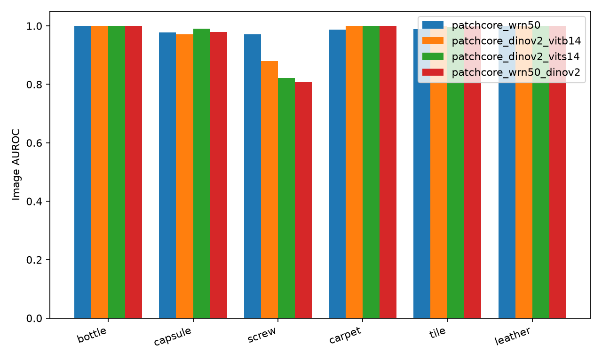
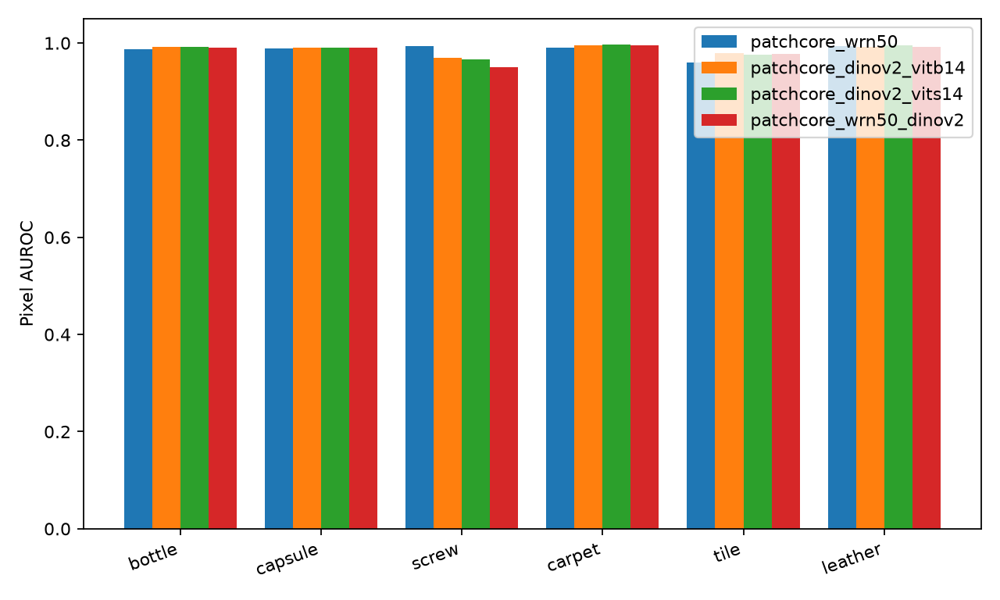
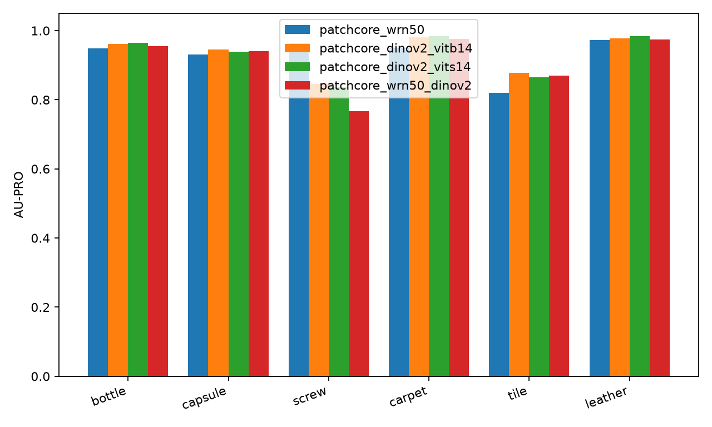

# DINOv2 features for PatchCore

This experiment replaces the frozen feature extractor in the WRN50 PatchCore baseline with self-supervised DINOv2 features. All three variants were fixed before evaluation and are evaluated on bottle, capsule, screw, carpet, tile, and leather; no per-category model or hyperparameter selection is performed.

## Protocol

| Run | Features returned to PatchCore | Feature grid | Channels per returned map |
| --- | --- | --- | --- |
| `patchcore_wrn50` | ImageNet WRN50 layer2, layer3 | 28×28, 14×14; PatchCore aligns to 28×28 | 512, 1024 |
| `patchcore_dinov2_vitb14` | DINOv2 ViT-B/14 blocks 5, 8, 11 (zero-indexed) | 32×32 | 768, 768, 768 |
| `patchcore_dinov2_vits14` | DINOv2 ViT-S/14 blocks 5, 8, 11 (zero-indexed) | 32×32 | 384, 384, 384 |
| `patchcore_wrn50_dinov2` | WRN50 layer2+3 followed by DINOv2 ViT-B/14 blocks 5, 8, 11 | all bilinearly aligned to 28×28 inside backbone | 512, 1024, 768, 768, 768 |

Each YAML changes only the feature-backbone configuration relative to `patchcore_wrn50.yaml`. The smaller model probes capacity within the DINOv2 feature-extractor factor, and the combined variant probes combining semantic and convolutional features. The default input pipeline remains resize 256 → center crop 224 → ImageNet normalization; DINOv2 alone bilinearly upsamples that normalized crop to 448 inside its forward pass. All selected intermediate DINOv2 tokens receive the same final LayerNorm, and timm removes the CLS token and any register tokens before returning spatial maps. The combined backbone keeps WRN50's original 224 input and returns five separate maps to the unchanged PatchCore per-layer MeanMapper and Aggregator, without feature reweighting.

Patch size **3**, target dimension **1024**, coreset ratio **0.1**, projection dimension **128**, neighbor count **9**, Gaussian sigma **4**, seed **0**, and the default batch size **32** are unchanged. Training uses the complete 90% normal train split; the held-out 10% normal validation split determines thresholds at image quantile 0.99 and pixel quantile 0.999. Evaluation maps stay at **224×224**. `image_f1` uses the validation threshold; any `image_f1_max_oracle` in the aggregate files is an **oracle reference**, not a model-selection criterion. Model fitting and prediction consume only `batch["image"]`.

The DINOv2 grid has 1024 positions per image versus 784 for the baseline, increasing the training candidate count and 10% memory-bank size by approximately 30.6%; the 28×28 combined grid was fixed a priori to retain the baseline patch count. The combined backbone resamples WRN50 layer3 before PatchCore unfolds patches, whereas baseline PatchCore unfolds it at 14×14 before alignment, so the backbone experiment also changes this branch's spatial sampling. No changes to PatchCore, preprocessing, scoring, threshold selection, or metrics are required.

## Reproduction

Use the shared virtual environment, offline cached pretrained weights, and GPU serialization:

```bash
export HF_HUB_OFFLINE=1
export MVTEC_ROOT=/home/eva/code/ma6216/industrial-visual-anomaly-detection/data/mvtec_ad
export PYTHONPATH=src
for run in patchcore_wrn50 patchcore_dinov2_vitb14 patchcore_dinov2_vits14 patchcore_wrn50_dinov2
do
  scripts/gpu_run.sh /home/eva/code/ma6216/industrial-visual-anomaly-detection/.venv/bin/python \
    -m ad.run --config "configs/${run}.yaml" --no-figs
done
/home/eva/code/ma6216/industrial-visual-anomaly-detection/.venv/bin/python \
  -m ad.aggregate --runs patchcore_wrn50 patchcore_dinov2_vitb14 \
  patchcore_dinov2_vits14 patchcore_wrn50_dinov2 --out reports/bonus/dinov2_tables
mkdir -p reports/bonus/dinov2_figures
mv reports/bonus/figures/bar_*.png reports/bonus/dinov2_figures/
```

Inference timing includes model prediction (feature extraction, memory-bank search, and image-score weighting) and map upsampling/smoothing, with CUDA synchronization and preloaded test batches; it excludes disk loading and metrics. `fit_seconds` includes feature extraction and coreset selection, and `peak_gpu_mem_gb` measures peak allocated CUDA memory over model creation, fitting, validation, and inference, not total device occupancy. The aggregate also retains a separate end-to-end inference timing including test loading. Runs used the shared RTX 5080 (16 GB), Python 3.12.3, torch 2.11.0+cu128 (CUDA runtime 12.8), and timm 1.0.31, in float32 without autocast.

## Resolution limitation

The 448 input is interpolated from a 224 crop and cannot restore scratches, threads, or texture details discarded by the initial resize and crop. The 32×32 DINOv2 map therefore provides more sampling positions without adding source-image information. Differences from WRN50 confound architecture, self-supervised pretraining, requested feature depths, and native feature-grid size within the single backbone factor, so they do not isolate the causal effect of self-supervision. A native higher-resolution input would need a separate experiment with matched preprocessing across every baseline and variant; it is not part of this comparison.

The coordinator approved the topic-specific `dinov2_figures` directory to avoid filename collisions between bonus experiments; the aggregator's three generated `bar_*.png` files are moved there after aggregation. Tables and the per-run summary remain in `dinov2_tables`.

## Verification

The complete repository suite, including GPU and data-marked tests, ran with the shared GPU lock and real cached weights:

```bash
HF_HUB_OFFLINE=1 \
MVTEC_ROOT=/home/eva/code/ma6216/industrial-visual-anomaly-detection/data/mvtec_ad \
scripts/gpu_run.sh /home/eva/code/ma6216/industrial-visual-anomaly-detection/.venv/bin/python -m pytest -q
```

```text
........................................................................ [ 56%]
.......................................................                  [100%]
127 passed in 22.09s
```

The new tests cover registered backbone names, unchanged experiment settings, both DINOv2 model sizes at 448, block ordering and normalized spatial-token values with CLS exclusion, exclusion of all four register tokens plus CLS in a register-equipped ViT, combined-grid channels, and PatchCore fit/predict on 20 normal bottle training images with 10 test images. The register-equipped test uses random weights to avoid requiring an additional checkpoint; both experiment model sizes and the combined backbone use the cached pretrained weights. Implementation commit: `628dd9c` (`feat(backbones): add frozen DINOv2 PatchCore feature variants`), on branch `exp/dinov2`.

## Results

All metrics use the complete test split for each category; means are unweighted category means (three objects, three textures, six overall). AUROC, F1, and AU-PRO are fractions; fit time is seconds, inference is milliseconds per image, and memory is GiB (1024³ bytes). Runtime includes the unchanged 10% memory bank, so these measurements compare complete PatchCore systems rather than isolated backbone forwards.

| Category/group | Backbone | Image AUROC | Image F1 | Pixel AUROC | AU-PRO | Fit (s) | Infer (ms/image) | Peak GPU (GiB) |
| --- | --- | ---: | ---: | ---: | ---: | ---: | ---: | ---: |
| bottle | WRN50 | 1.0000 | 1.0000 | 0.9867 | 0.9493 | 2.69 | 2.53 | 1.32 |
| bottle | DINOv2-B | 1.0000 | 0.9921 | 0.9915 | 0.9620 | 5.20 | 12.47 | 3.14 |
| bottle | DINOv2-S | 1.0000 | 1.0000 | 0.9920 | 0.9650 | 3.97 | 5.91 | 2.03 |
| bottle | WRN50+DINOv2-B | 1.0000 | 1.0000 | 0.9906 | 0.9557 | 4.61 | 13.49 | 2.94 |
| capsule | WRN50 | 0.9777 | 0.8360 | 0.9888 | 0.9313 | 3.45 | 2.64 | 1.42 |
| capsule | DINOv2-B | 0.9713 | 0.8601 | 0.9905 | 0.9454 | 5.66 | 12.54 | 3.27 |
| capsule | DINOv2-S | 0.9900 | 0.8526 | 0.9906 | 0.9398 | 4.66 | 5.97 | 2.15 |
| capsule | WRN50+DINOv2-B | 0.9793 | 0.8022 | 0.9901 | 0.9400 | 4.99 | 13.61 | 3.03 |
| screw | WRN50 | 0.9705 | 0.8837 | 0.9932 | 0.9627 | 4.63 | 3.22 | 1.83 |
| screw | DINOv2-B | 0.8791 | 0.6740 | 0.9688 | 0.8452 | 9.05 | 13.63 | 3.64 |
| screw | DINOv2-S | 0.8223 | 0.7385 | 0.9670 | 0.8356 | 7.15 | 7.05 | 2.53 |
| screw | WRN50+DINOv2-B | 0.8094 | 0.6630 | 0.9510 | 0.7677 | 7.40 | 14.20 | 3.32 |
| carpet | WRN50 | 0.9872 | 0.9355 | 0.9898 | 0.9503 | 4.37 | 2.94 | 1.61 |
| carpet | DINOv2-B | 0.9996 | 0.9780 | 0.9956 | 0.9801 | 7.81 | 13.23 | 3.39 |
| carpet | DINOv2-S | 0.9996 | 0.9834 | 0.9962 | 0.9840 | 6.38 | 6.63 | 2.28 |
| carpet | WRN50+DINOv2-B | 1.0000 | 0.9889 | 0.9952 | 0.9765 | 6.57 | 13.93 | 3.13 |
| tile | WRN50 | 0.9892 | 0.8947 | 0.9602 | 0.8192 | 3.16 | 2.65 | 1.42 |
| tile | DINOv2-B | 0.9993 | 0.9825 | 0.9786 | 0.8782 | 5.80 | 12.74 | 3.27 |
| tile | DINOv2-S | 0.9949 | 0.9940 | 0.9756 | 0.8654 | 4.49 | 6.14 | 2.15 |
| tile | WRN50+DINOv2-B | 0.9989 | 0.9822 | 0.9784 | 0.8701 | 5.04 | 13.63 | 3.03 |
| leather | WRN50 | 1.0000 | 0.9634 | 0.9930 | 0.9722 | 3.52 | 2.77 | 1.42 |
| leather | DINOv2-B | 1.0000 | 1.0000 | 0.9923 | 0.9775 | 6.37 | 12.86 | 3.27 |
| leather | DINOv2-S | 1.0000 | 1.0000 | 0.9947 | 0.9843 | 5.07 | 6.27 | 2.15 |
| leather | WRN50+DINOv2-B | 1.0000 | 1.0000 | 0.9916 | 0.9749 | 5.46 | 13.75 | 3.03 |
| mean (objects) | WRN50 | 0.9827 | 0.9066 | 0.9896 | 0.9478 | 3.59 | 2.80 | 1.52 |
| mean (objects) | DINOv2-B | 0.9501 | 0.8421 | 0.9836 | 0.9175 | 6.64 | 12.88 | 3.35 |
| mean (objects) | DINOv2-S | 0.9374 | 0.8637 | 0.9832 | 0.9135 | 5.26 | 6.31 | 2.24 |
| mean (objects) | WRN50+DINOv2-B | 0.9295 | 0.8217 | 0.9773 | 0.8878 | 5.67 | 13.77 | 3.10 |
| mean (textures) | WRN50 | 0.9921 | 0.9312 | 0.9810 | 0.9139 | 3.68 | 2.79 | 1.48 |
| mean (textures) | DINOv2-B | 0.9996 | 0.9868 | 0.9888 | 0.9452 | 6.66 | 12.94 | 3.31 |
| mean (textures) | DINOv2-S | 0.9982 | 0.9925 | 0.9888 | 0.9446 | 5.31 | 6.34 | 2.19 |
| mean (textures) | WRN50+DINOv2-B | 0.9996 | 0.9904 | 0.9884 | 0.9405 | 5.69 | 13.77 | 3.06 |
| mean (all) | WRN50 | 0.9874 | 0.9189 | 0.9853 | 0.9308 | 3.64 | 2.79 | 1.50 |
| mean (all) | DINOv2-B | 0.9749 | 0.9145 | 0.9862 | 0.9314 | 6.65 | 12.91 | 3.33 |
| mean (all) | DINOv2-S | 0.9678 | 0.9281 | 0.9860 | 0.9290 | 5.29 | 6.33 | 2.22 |
| mean (all) | WRN50+DINOv2-B | 0.9646 | 0.9061 | 0.9828 | 0.9141 | 5.68 | 13.77 | 3.08 |

The complete aggregate output, including per-category tables for every metric and the explicitly labelled oracle F1 reference, is in [dinov2_tables/summary.md](dinov2_tables/summary.md). Performance tables retain four-decimal precision in that directory. The aggregate charts are in [dinov2_figures](dinov2_figures).

## Analysis

On the three object categories, mean image AUROC falls from **0.9827** (WRN50) to **0.9501** (ViT-B), **0.9374** (ViT-S), and **0.9295** (combined), so these features do not deliver a general improvement on the hard objects under this protocol. Screw drives the regression: its image AUROC changes from **0.9705** to **0.8791 / 0.8223 / 0.8094**, and AU-PRO changes from **0.9627** to **0.8452 / 0.8356 / 0.7677**, in B / S / combined order. Capsule is mixed: ViT-S improves image AUROC from **0.9777** to **0.9900**, ViT-B decreases it to **0.9713**, and all three improve localization AU-PRO from **0.9313** to **0.9454 / 0.9398 / 0.9400**. Textures benefit more consistently, with mean image F1 improving from **0.9312** to **0.9868 / 0.9925 / 0.9904** and mean AU-PRO from **0.9139** to **0.9452 / 0.9446 / 0.9405**, largely through carpet and tile while every model already reaches leather image AUROC **1.0000**. Across all six categories, ViT-B's mean AU-PRO is nearly unchanged (**0.9314** versus **0.9308**), ViT-S has higher validation-threshold image F1 (**0.9281** versus **0.9189**), and every variant has lower mean image AUROC, illustrating that ranking and threshold transfer measure different behavior.

A plausible interpretation is that semantic invariance and the selected late transformer features preserve conspicuous texture changes while weakening sensitivity to small local screw defects, but the especially poor combined result shows that complementary features do not automatically survive the unchanged feature fusion; this is an inference from the measurements, not an established mechanism. Mean inference rises from **2.79 ms/image** to **12.91 / 6.33 / 13.77 ms/image** (**4.63× / 2.27× / 4.93×**), making the smaller DINOv2 model cheaper than ViT-B while still substantially slower than the baseline. Mean fit time rises from **3.64 s** to **6.65 / 5.29 / 5.68 s**, and mean peak allocated memory rises from **1.50 GiB** to **3.33 / 2.22 / 3.08 GiB**, with the combined model's baseline-sized grid saving fitting and memory cost relative to standalone ViT-B despite using two backbones. The standalone DINOv2 grid increases the 10% memory-bank size by approximately **30.6%**, contributing to search cost, while upsampling the original **224** crop to **448** cannot recover lost thread, scratch, or texture detail and therefore limits the value of the denser map. These are descriptive single-seed results without uncertainty intervals, and architecture, pretraining objective, requested feature depths, native grid, and the combined branch's resampling order differ within the backbone factor, so the changes cannot be attributed to self-supervision alone.






