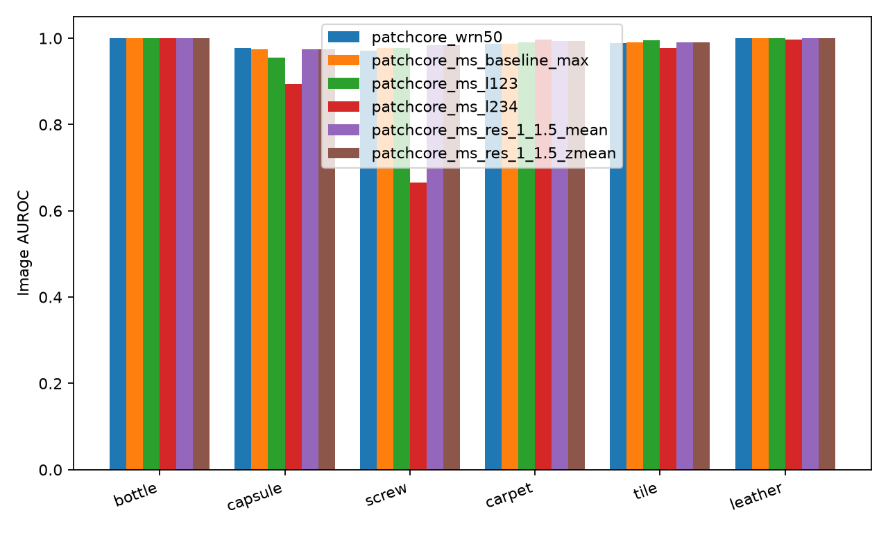
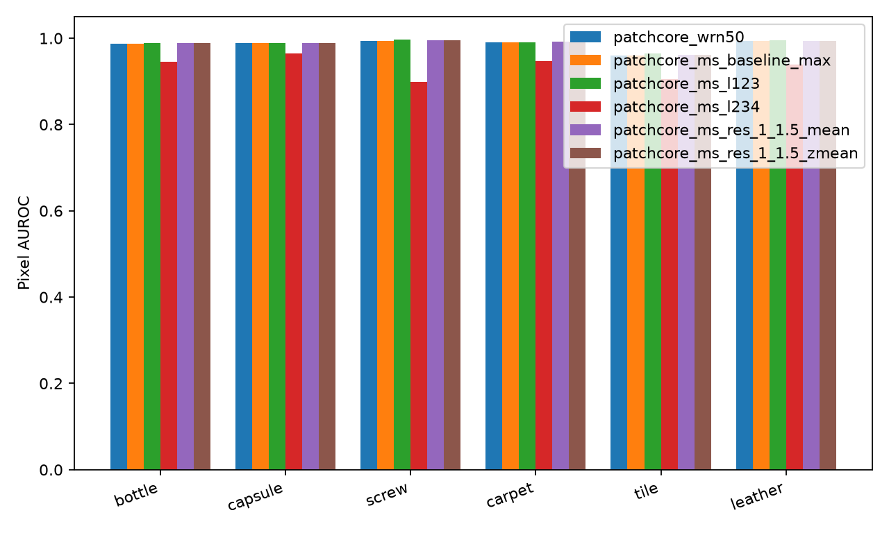
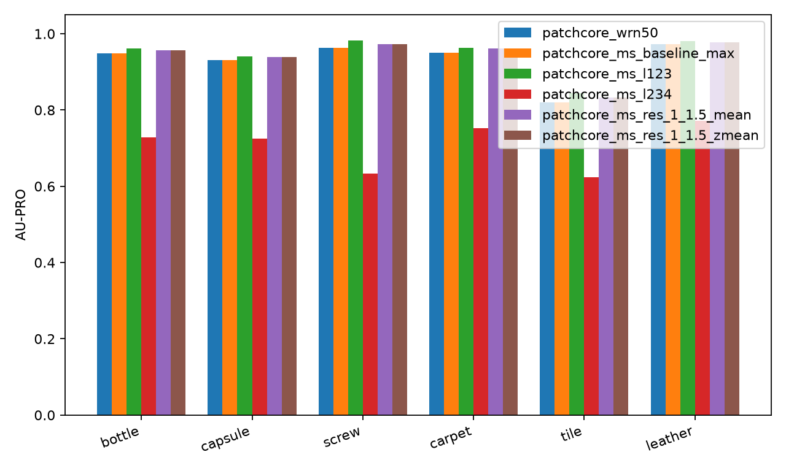

# Multi-scale PatchCore

This experiment compares feature-hierarchy fusion and input-pyramid fusion with
PatchCore-WRN50. All variants were specified before evaluation: a fixed seed of
0, the six assigned categories, normal training only, the deterministic 10%
normal validation holdout, resize 256 followed by centre crop 224, 10% greedy
coreset, 1024-dimensional embeddings, 128-dimensional random projection,
3-by-3 patch neighbourhoods, and shared Gaussian smoothing with sigma 4.
The Eq. 7 baseline metrics are reused from the coordinator's complete main-branch
run under the same shared GPU lock, after verifying its model configuration and
uncapped 224-pixel training protocol; the max control and all multi-scale variants
were run in this worktree. Test labels and masks enter only the shared evaluator; no variant or parameter
is selected by its test performance. Evaluation maps remain 224 by 224.

| Run | Change and image scoring |
| --- | --- |
| `patchcore_wrn50` | Baseline layers 2+3, native grid 28x28, Eq. 7 reweighting |
| `patchcore_ms_baseline_max` | Same fitted model, shared max scoring control |
| `patchcore_ms_l123` | Layers 1+2+3, native grid 56x56, Eq. 7 reweighting |
| `patchcore_ms_l234` | Layers 2+3+4, native grid 28x28, Eq. 7 reweighting |
| `patchcore_ms_res_1_1.5_mean` | Independently fitted inputs at 224 and 336, raw-map mean, shared max |
| `patchcore_ms_res_1_1.5_zmean` | Same pyramid with training-only per-scale z-normalisation, shared max |

The existing PatchCore implementation uses the first requested layer as its
feature grid and bilinearly aligns subsequent layer embeddings to that grid.
The pyramid also uses bilinear interpolation with `align_corners=False`, first
inside the model to resize its input and then to align 42x42 maps to the 1.0
scale's 28x28 grid. It returns `image_scores=None`: the shared pipeline takes the
maximum after upsampling and smoothing, so this is **not** Eq. 7 reweighting or
the unsmoothed native-grid maximum. The max-scoring baseline isolates this score
change; compare hierarchy variants against the Eq. 7 baseline and pyramid
variants against the max-scoring baseline.

For zmean, each scale computes the Euclidean nearest-neighbour distance from
each selected coreset patch to the **full normal training feature bank**,
excluding that patch's own original row. The population mean and standard
deviation of these distances are frozen after fit; zero standard deviation
uses a unit divisor. This is the permitted coreset-to-full-bank approximation,
not leave-one-image-out calibration: adjacent patches from the same training
image can be neighbours, and the query/reference-bank roles differ from
prediction, so these statistics need not match held-out normal scores. No
validation or test images contribute to these statistics. Each
scale retains its own backbone and bank; full training features are discarded
after fitting and calibration.

## Results

Every mean is an unweighted category mean: objects = bottle/capsule/screw; textures = carpet/tile/leather. All 36 run/category combinations are present. AUROC, F1, and AU-PRO are fractions; fit time is seconds, inference is milliseconds per image, and peak memory is GiB of allocated CUDA tensors. Image F1 uses only normal-validation thresholds (99th percentile); pixel thresholds use the 99.9th percentile. The aggregate's `image_f1_max_oracle` is an oracle reference, not a threshold used by these runs.

### `patchcore_wrn50`

| Category | Image AUROC | Image F1 | Pixel AUROC | AU-PRO | Fit s | Infer ms/image | Peak GiB |
| --- | ---: | ---: | ---: | ---: | ---: | ---: | ---: |
| bottle | 1.0000 | 1.0000 | 0.9867 | 0.9493 | 2.692 | 2.528 | 1.317 |
| capsule | 0.9777 | 0.8360 | 0.9888 | 0.9313 | 3.447 | 2.624 | 1.420 |
| screw | 0.9705 | 0.8837 | 0.9932 | 0.9627 | 4.621 | 3.208 | 1.825 |
| carpet | 0.9872 | 0.9355 | 0.9898 | 0.9503 | 4.344 | 2.932 | 1.610 |
| tile | 0.9892 | 0.8947 | 0.9602 | 0.8192 | 3.167 | 2.640 | 1.420 |
| leather | 1.0000 | 0.9634 | 0.9930 | 0.9722 | 3.509 | 2.761 | 1.420 |
| mean (objects) | 0.9827 | 0.9066 | 0.9896 | 0.9478 | 3.587 | 2.787 | 1.521 |
| mean (textures) | 0.9921 | 0.9312 | 0.9810 | 0.9139 | 3.673 | 2.778 | 1.484 |
| mean (all) | 0.9874 | 0.9189 | 0.9853 | 0.9308 | 3.630 | 2.782 | 1.502 |

### `patchcore_ms_baseline_max`

| Category | Image AUROC | Image F1 | Pixel AUROC | AU-PRO | Fit s | Infer ms/image | Peak GiB |
| --- | ---: | ---: | ---: | ---: | ---: | ---: | ---: |
| bottle | 1.0000 | 1.0000 | 0.9867 | 0.9493 | 2.693 | 2.526 | 1.317 |
| capsule | 0.9745 | 0.8660 | 0.9888 | 0.9313 | 3.468 | 2.627 | 1.413 |
| screw | 0.9779 | 0.8679 | 0.9932 | 0.9627 | 4.653 | 3.214 | 1.817 |
| carpet | 0.9868 | 0.9368 | 0.9898 | 0.9503 | 4.383 | 2.943 | 1.602 |
| tile | 0.9906 | 0.9756 | 0.9602 | 0.8192 | 3.183 | 2.647 | 1.413 |
| leather | 1.0000 | 0.9583 | 0.9930 | 0.9722 | 3.537 | 2.765 | 1.413 |
| mean (objects) | 0.9841 | 0.9113 | 0.9896 | 0.9478 | 3.605 | 2.789 | 1.516 |
| mean (textures) | 0.9925 | 0.9569 | 0.9810 | 0.9139 | 3.701 | 2.785 | 1.476 |
| mean (all) | 0.9883 | 0.9341 | 0.9853 | 0.9308 | 3.653 | 2.787 | 1.496 |

### `patchcore_ms_l123`

| Category | Image AUROC | Image F1 | Pixel AUROC | AU-PRO | Fit s | Infer ms/image | Peak GiB |
| --- | ---: | ---: | ---: | ---: | ---: | ---: | ---: |
| bottle | 1.0000 | 0.9844 | 0.9881 | 0.9616 | 22.714 | 22.020 | 4.688 |
| capsule | 0.9549 | 0.7640 | 0.9893 | 0.9409 | 25.445 | 23.023 | 5.071 |
| screw | 0.9777 | 0.8950 | 0.9964 | 0.9821 | 52.153 | 32.577 | 6.985 |
| carpet | 0.9912 | 0.9462 | 0.9910 | 0.9625 | 41.248 | 28.722 | 6.125 |
| tile | 0.9957 | 0.8169 | 0.9646 | 0.8445 | 28.254 | 23.744 | 5.071 |
| leather | 1.0000 | 0.9840 | 0.9947 | 0.9809 | 31.818 | 25.106 | 5.359 |
| mean (objects) | 0.9775 | 0.8811 | 0.9913 | 0.9616 | 33.437 | 25.873 | 5.582 |
| mean (textures) | 0.9956 | 0.9157 | 0.9834 | 0.9293 | 33.773 | 25.857 | 5.519 |
| mean (all) | 0.9866 | 0.8984 | 0.9873 | 0.9454 | 33.605 | 25.865 | 5.550 |

### `patchcore_ms_l234`

| Category | Image AUROC | Image F1 | Pixel AUROC | AU-PRO | Fit s | Infer ms/image | Peak GiB |
| --- | ---: | ---: | ---: | ---: | ---: | ---: | ---: |
| bottle | 1.0000 | 0.9920 | 0.9449 | 0.7287 | 2.718 | 2.982 | 1.495 |
| capsule | 0.8947 | 0.8932 | 0.9651 | 0.7251 | 3.506 | 3.100 | 1.591 |
| screw | 0.6653 | 0.0650 | 0.8981 | 0.6327 | 4.665 | 3.677 | 1.974 |
| carpet | 0.9968 | 0.9670 | 0.9478 | 0.7517 | 4.442 | 3.407 | 1.759 |
| tile | 0.9784 | 0.9756 | 0.9057 | 0.6244 | 3.216 | 3.114 | 1.591 |
| leather | 0.9976 | 0.9787 | 0.9391 | 0.7723 | 3.578 | 3.238 | 1.591 |
| mean (objects) | 0.8533 | 0.6501 | 0.9360 | 0.6955 | 3.630 | 3.253 | 1.687 |
| mean (textures) | 0.9909 | 0.9738 | 0.9309 | 0.7161 | 3.746 | 3.253 | 1.647 |
| mean (all) | 0.9221 | 0.8119 | 0.9334 | 0.7058 | 3.688 | 3.253 | 1.667 |

### `patchcore_ms_res_1_1.5_mean`

| Category | Image AUROC | Image F1 | Pixel AUROC | AU-PRO | Fit s | Infer ms/image | Peak GiB |
| --- | ---: | ---: | ---: | ---: | ---: | ---: | ---: |
| bottle | 1.0000 | 1.0000 | 0.9882 | 0.9570 | 10.873 | 11.365 | 3.039 |
| capsule | 0.9737 | 0.8482 | 0.9896 | 0.9392 | 13.020 | 11.762 | 3.259 |
| screw | 0.9842 | 0.9286 | 0.9947 | 0.9725 | 21.956 | 15.334 | 4.200 |
| carpet | 0.9932 | 0.9368 | 0.9915 | 0.9612 | 18.624 | 13.767 | 3.699 |
| tile | 0.9910 | 0.9756 | 0.9623 | 0.8334 | 13.148 | 11.997 | 3.261 |
| leather | 1.0000 | 0.9684 | 0.9938 | 0.9769 | 14.720 | 12.634 | 3.265 |
| mean (objects) | 0.9860 | 0.9256 | 0.9908 | 0.9562 | 15.283 | 12.820 | 3.499 |
| mean (textures) | 0.9947 | 0.9603 | 0.9825 | 0.9238 | 15.497 | 12.799 | 3.408 |
| mean (all) | 0.9903 | 0.9429 | 0.9867 | 0.9400 | 15.390 | 12.810 | 3.454 |

### `patchcore_ms_res_1_1.5_zmean`

| Category | Image AUROC | Image F1 | Pixel AUROC | AU-PRO | Fit s | Infer ms/image | Peak GiB |
| --- | ---: | ---: | ---: | ---: | ---: | ---: | ---: |
| bottle | 1.0000 | 1.0000 | 0.9882 | 0.9569 | 12.413 | 11.376 | 3.039 |
| capsule | 0.9737 | 0.8482 | 0.9896 | 0.9390 | 14.695 | 11.761 | 3.259 |
| screw | 0.9842 | 0.9286 | 0.9947 | 0.9724 | 25.501 | 15.340 | 4.200 |
| carpet | 0.9932 | 0.9368 | 0.9915 | 0.9612 | 21.352 | 13.791 | 3.699 |
| tile | 0.9910 | 0.9756 | 0.9622 | 0.8329 | 14.987 | 12.005 | 3.261 |
| leather | 1.0000 | 0.9684 | 0.9939 | 0.9770 | 16.779 | 12.639 | 3.265 |
| mean (objects) | 0.9860 | 0.9256 | 0.9908 | 0.9561 | 17.537 | 12.825 | 3.499 |
| mean (textures) | 0.9947 | 0.9603 | 0.9825 | 0.9237 | 17.706 | 12.812 | 3.408 |
| mean (all) | 0.9903 | 0.9429 | 0.9867 | 0.9399 | 17.621 | 12.819 | 3.454 |

## Cost by scale

Pyramid timings below include input resizing, feature extraction and PatchCore's nearest-neighbour search (including its unused Eq. 7 score). They exclude map alignment/fusion and shared smoothing, which remain included in the main inference column. Times are CUDA synchronised and measured on preloaded test batches; loader/I/O latency is reported separately by aggregate as `infer_ms_per_image_e2e`. Bank sizes below exclude the frozen backbone and temporary tensors; the main table reports the complete run's peak allocation.

| Fusion | Category | Scale | Grid | Bank patches | Bank MiB | Fit s | Infer ms/image | Fit mean | Fit std |
| --- | --- | ---: | --- | ---: | ---: | ---: | ---: | ---: | ---: |
| mean | bottle | 1.0 | 28x28 | 14739 | 57.574 | 2.688 | 2.463 | — | — |
| mean | bottle | 1.5 | 42x42 | 33163 | 129.543 | 8.185 | 8.819 | — | — |
| mean | capsule | 1.0 | 28x28 | 15444 | 60.328 | 3.470 | 2.574 | — | — |
| mean | capsule | 1.5 | 42x42 | 34750 | 135.742 | 9.550 | 9.113 | — | — |
| mean | screw | 1.0 | 28x28 | 22579 | 88.199 | 4.656 | 3.159 | — | — |
| mean | screw | 1.5 | 42x42 | 50803 | 198.449 | 17.300 | 12.107 | — | — |
| mean | carpet | 1.0 | 28x28 | 19756 | 77.172 | 4.374 | 2.882 | — | — |
| mean | carpet | 1.5 | 42x42 | 44452 | 173.641 | 14.250 | 10.812 | — | — |
| mean | tile | 1.0 | 28x28 | 16228 | 63.391 | 3.181 | 2.591 | — | — |
| mean | tile | 1.5 | 42x42 | 36514 | 142.633 | 9.967 | 9.327 | — | — |
| mean | leather | 1.0 | 28x28 | 17248 | 67.375 | 3.548 | 2.708 | — | — |
| mean | leather | 1.5 | 42x42 | 38808 | 151.594 | 11.173 | 9.855 | — | — |
| zmean | bottle | 1.0 | 28x28 | 14739 | 57.574 | 2.966 | 2.467 | 0.7668 | 0.1309 |
| zmean | bottle | 1.5 | 42x42 | 33163 | 129.543 | 9.447 | 8.827 | 0.6911 | 0.1379 |
| zmean | capsule | 1.0 | 28x28 | 15444 | 60.328 | 3.770 | 2.573 | 0.5738 | 0.1218 |
| zmean | capsule | 1.5 | 42x42 | 34750 | 135.742 | 10.925 | 9.115 | 0.5674 | 0.1252 |
| zmean | screw | 1.0 | 28x28 | 22579 | 88.199 | 5.275 | 3.161 | 0.7234 | 0.1785 |
| zmean | screw | 1.5 | 42x42 | 50803 | 198.449 | 20.227 | 12.110 | 0.6902 | 0.1831 |
| zmean | carpet | 1.0 | 28x28 | 19756 | 77.172 | 4.852 | 2.886 | 0.5844 | 0.0712 |
| zmean | carpet | 1.5 | 42x42 | 44452 | 173.641 | 16.500 | 10.834 | 0.5943 | 0.0697 |
| zmean | tile | 1.0 | 28x28 | 16228 | 63.391 | 3.504 | 2.592 | 0.7475 | 0.0823 |
| zmean | tile | 1.5 | 42x42 | 36514 | 142.633 | 11.483 | 9.339 | 0.8164 | 0.0896 |
| zmean | leather | 1.0 | 28x28 | 17248 | 67.375 | 3.900 | 2.709 | 0.5395 | 0.0676 |
| zmean | leather | 1.5 | 42x42 | 38808 | 151.594 | 12.878 | 9.858 | 0.5681 | 0.0630 |

At fixed training-image count, layer1 gives four times as many patches/bank entries as layer2; with a 10% greedy coreset the projected scan work grows roughly 16-fold (candidate count times selection count). The 1.5 input scale has 2.25 times as many patches, giving a combined 3.25 times baseline bank storage; its own greedy selection work is roughly 5.06 times baseline. Calibrating zmean additionally searches each coreset against the full training bank; the full bank is discarded after fit.

Measured layer1 mean fit and inference costs were 9.26x and 9.30x the baseline, respectively; feature extraction and fixed overheads make total costs scale differently from the coreset scan bound; mean peak allocation rose 3.69x (5.55 versus 1.50 GiB).

Raw pyramid mean used 4.60 times the max control's mean inference time and 2.31 times its mean peak allocation; zmean fit took 1.14 times raw-mean fit because calibration performs an additional full-bank search.

## Analysis

Adding layer1 changed overall pixel AUROC by +0.0021 and AU-PRO by +0.0146 relative to the Eq. 7 baseline, but these localisation gains come with image-level detection losses.
The localisation-versus-detection trade-off is clearest on capsule: image AUROC fell from 0.978 to 0.955 and F1 from 0.836 to 0.764; tile F1 fell from 0.895 to 0.817, and mean F1 from 0.919 to 0.898.
Layer1's AU-PRO gains were +0.0194 on screw, +0.0096 on capsule, +0.0122 on carpet and +0.0253 on tile, so both of these textures also benefited in localisation.
Adding layer4 instead changed overall image AUROC by -0.0653 and AU-PRO by -0.2250; a possible explanation is that its coarse 7x7 layer4 features dilute fine defect evidence when the fused embedding is pooled back to 1024 dimensions.
Relative to the max-scoring control, raw pyramid mean changed image AUROC by +0.0021, pixel AUROC by +0.0014, and AU-PRO by +0.0092.

Original-resolution median GT areas from the [dataset analysis on main](../dataset/dataset_stats.md), compared with the fixed pyramid's category-level results

| Category | Median defect area | Max-control AU-PRO | Pyramid mean AU-PRO | Change |
| --- | ---: | ---: | ---: | ---: |
| screw | 0.29% | 0.9627 | 0.9725 | +0.0098 |
| capsule | 0.43% | 0.9313 | 0.9392 | +0.0079 |
| carpet | 1.48% | 0.9503 | 0.9612 | +0.0109 |
| tile | 7.93% | 0.8192 | 0.8334 | +0.0142 |

These gains are not concentrated in the smallest-defect categories: carpet and tile improve at least as much as screw and capsule, although whole-category metrics do not isolate capsule scratches (median original defect area 0.64%) or control for other category differences.
Within each category, zmean is a positive affine transform of `r*d1.0 + d1.5`, where the `d` terms are aligned raw distance maps and `r = std1.5 / std1.0`: subtracting the scale means adds only a uniform offset, so only the std ratio can change rankings and hence AUROC or AU-PRO.
That ratio is about 1.03–1.09 in the reviewer's bottle/screw/tile diagnostic (0.93–1.09 across all six categories), making zmean effectively equivalent to mean here: image AUROC and F1 are identical, and mean AU-PRO changes by only -0.0001.
The reviewer's held-out normal-validation diagnostic found biased absolute proxy statistics (tile mean 0.75 versus 1.24 held-out; screw std 0.18 versus 0.10), while the std ratio is roughly right with up to about 11% relative error, including tile's proxy ratio 1.09 versus held-out 0.98 in the opposite direction from unity.
The mismatch arises because calibration queries k-center-selected coreset patches against the full training bank with same-image spatial neighbours retained, whereas prediction queries all patches against the coreset; the validation diagnostic was used only to explain the existing result and never for fitting, calibration or tuning.

## Reproduction and validation

Run `bash reports/bonus/multiscale_reproduce.sh` from the worktree root, then `PYTHONPATH=src /home/eva/code/ma6216/industrial-visual-anomaly-detection/.venv/bin/python reports/bonus/multiscale_report.py`. The reproduction script runs every category through the shared GPU lock and preserves baseline preprocessing; aggregate is generated in a temporary directory before copying to these task-specific report paths.

- Full suite, with `HF_HUB_OFFLINE=1`, `MVTEC_ROOT` set and `scripts/gpu_run.sh`: **130 passed in 20.17s**.
- Focused CPU multi-scale tests: **18 passed, 1 deselected in 0.62s**.
- Twenty-training-image bottle GPU/data smoke: **1 passed in 2.40s**.
- Tests cover map/grid alignment, exact 1.0-scale memory-bank equivalence to plain PatchCore for mean and zmean, identical-scale raw and standardised map equivalence, source-row exclusion, fit-only frozen z statistics, constant references, invalid scales, and first-layer hierarchy grids.

Aggregate tables and the labelled oracle reference are in [multiscale_tables/summary.md](multiscale_tables/summary.md); all numeric resource tables and per-category values are in [metrics_long.csv](multiscale_tables/metrics_long.csv).

