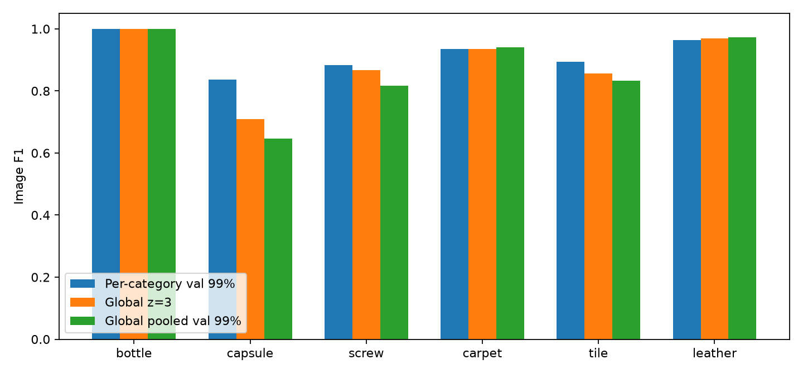

# PatchCore post-processing bonus

Protocol: PatchCore-WRN50, layer2 + layer3, resize 256 then centre crop 224, evaluation at 224, patch size 3, target dimension 1024, 10% coreset, projection dimension 128, nine support neighbours, seed 0, and the standard 10% normal training holdout for validation. All six categories and all six requested variants are included; every variant changes one scoring factor from the baseline. Values were specified before test evaluation: top 1% mean; plain smoothed-map max; Gaussian sigma 2, 8, or 0 instead of 4; or validation z-scoring with the fixed global z=3 cutoff and an additional pooled-normal-validation 99% cutoff. Adaptive smoothing was omitted because stride/2 equals the baseline sigma 4 at WRN50 layer2 stride 8.

Image and pixel statistics use separate population means and standard deviations fitted per category only on normal validation outputs, before predicting the test split. A constant reference uses scale 1. The pooled cutoff weights normal validation images equally across all six products; it uses neither test scores nor test annotations. `image_f1` retains each category's validation 99% threshold, `image_f1_global` uses z=3 everywhere, and `image_f1_global_pooled` uses the same pooled validation cutoff everywhere. Pixel maps also support fixed z=3, with `pixel_f1_global` measured over all test images; the existing `pixel_f1` convention remains restricted to anomalous images. All oracle maximum-F1 values in the aggregate tables are test-label oracle references, never deployment thresholds.

The baseline was fitted once per category and cached raw validation/test patch maps plus model image scores; the variants replayed exactly those predictions using `--prediction-cache results/postproc_raw_cache`. Cache reuse checks that all model, data, and seed settings match, and the cache contains no labels or masks. Fit time and peak GPU memory are inherited from that common baseline measurement; inference time adds the shared measured model prediction cost to a newly measured GPU upsampling/smoothing pass for each variant. These are controlled post-processing cost estimates rather than independent retraining measurements, and the runner's timing convention excludes image-score aggregation, z-score application, calibration, and evaluation. The six-category GPU experiments and the GPU-inclusive test suite all used `scripts/gpu_run.sh`.

## All-category means

All means give each category equal weight; object and texture means each contain three categories, and the overall mean contains all six. Timing and memory follow the shared-prediction convention described above.

| run | image_auroc | image_f1 | pixel_auroc | aupro | fit_seconds | infer_ms_per_image | peak_gpu_mem_gb |
| --- | ---: | ---: | ---: | ---: | ---: | ---: | ---: |
| patchcore_wrn50 | 0.9874 | 0.9189 | 0.9853 | 0.9308 | 3.6261 | 2.7919 | 1.5023 |
| pp_topk1 | 0.9878 | 0.9347 | 0.9853 | 0.9308 | 3.6261 | 2.7897 | 1.5023 |
| pp_max | 0.9883 | 0.9341 | 0.9853 | 0.9308 | 3.6261 | 2.7920 | 1.5023 |
| pp_sigma2 | 0.9874 | 0.9189 | 0.9852 | 0.9322 | 3.6261 | 2.7832 | 1.5023 |
| pp_sigma8 | 0.9874 | 0.9189 | 0.9848 | 0.9233 | 3.6261 | 2.8079 | 1.5023 |
| pp_nosmooth | 0.9874 | 0.9189 | 0.9851 | 0.9324 | 3.6261 | 2.7531 | 1.5023 |
| pp_zscore_global | 0.9874 | 0.9189 | 0.9853 | 0.9308 | 3.6261 | 2.7912 | 1.5023 |

## Analysis

Top-1% mean raises macro image F1 from 0.9189 to 0.9347, with plain smoothed-map max close at 0.9341, while their image AUROC changes are small.
Top-1% helps capsule (0.8360 to 0.9216) and tile (0.8947 to 0.9818), but hurts screw F1 (0.8837 to 0.8293) despite improving its AUROC (0.9705 to 0.9754), showing that validation calibration can outweigh a ranking gain.
At 224×224, top-1% averages 501 pixels, so sustained spatial evidence can suppress isolated peaks while a very compact defect can be diluted relative to max; this is a mechanism-based interpretation rather than a defect-size-stratified measurement.
The requested max comparison also moves aggregation from the raw feature map to the smoothed pixel map, so its difference from the baseline does not isolate Eq 7 reweighting alone.
Changing sigma leaves image metrics identical because those variants retain model-provided Eq 7 image scores, and changing image aggregation leaves pixel metrics identical.

Sigma 2 raises mean AU-PRO from 0.9308 to 0.9322 while slightly lowering pixel AUROC from 0.9853 to 0.9852; removing Gaussian blur gives 0.9324 AU-PRO and 0.9851 pixel AUROC, with tile showing the largest pixel-AUROC cost (0.9602 to 0.9589).
Sigma 8 lowers AU-PRO in all six categories and lowers its mean to 0.9233, consistent with excess spreading of anomaly evidence into background and loss of fine region boundaries.
Validation z-scoring preserves image AUROC exactly and changes pixel AUROC and AU-PRO by at most 5.4×10⁻¹² and 1.6×10⁻⁸ respectively in this sweep, as expected for a positive affine transform up to float32 rounding.
One image cutoff reduces macro F1 from 0.9189 to 0.8898 at z=3 and 0.8685 at the pooled cutoff 3.326997, with capsule recall falling to 0.5505 and 0.4771, while leather F1 improves slightly.
Normal validation has 4/151 images above z=3 (2.65%) and 2/151 above the pooled cutoff (1.32%), so the Gaussian 0.13% tail reference does not describe these small category holdouts; a shared operating cutoff still needs category-specific calibration and incurs a measurable recall cost on this product mix.

## Deployment thresholds

The fixed threshold is z=3 for every category; the additional pooled image threshold is 3.3269968033, estimated from 151 normal validation image scores. Per-category thresholds are recalculated on z-scored validation outputs and yield the same F1 as the raw baseline. Category reference means, standard deviations and sample sizes are recorded in every normalized metrics.json and in [validation_statistics.md](postproc_tables/validation_statistics.md).

| category | per-category val 99% F1 | global z=3 F1 | pooled val 99% F1 |
| --- | ---: | ---: | ---: |
| bottle | 1.0000 | 1.0000 | 1.0000 |
| capsule | 0.8360 | 0.7101 | 0.6460 |
| screw | 0.8837 | 0.8679 | 0.8177 |
| carpet | 0.9355 | 0.9355 | 0.9405 |
| tile | 0.8947 | 0.8571 | 0.8333 |
| leather | 0.9634 | 0.9684 | 0.9735 |
| mean (objects) | 0.9066 | 0.8593 | 0.8212 |
| mean (textures) | 0.9312 | 0.9203 | 0.9158 |
| mean (all) | 0.9189 | 0.8898 | 0.8685 |

Detailed global precision/recall appears in [global_thresholds.md](postproc_tables/global_thresholds.md); empirical normal validation exceedance counts appear in [validation_fpr.json](postproc_tables/validation_fpr.json). The pooled 99% quantile uses image weighting, so categories with more validation images contribute more observations.



## Full per-category results

Each block includes bottle, capsule and screw objects, carpet, tile and leather textures, and the three macro means. All 42 category/variant evaluations succeeded.

| run | category | image_auroc | image_f1 | pixel_auroc | aupro | fit_seconds | infer_ms_per_image | peak_gpu_mem_gb |
| --- | ---: | ---: | ---: | ---: | ---: | ---: | ---: | ---: |
| patchcore_wrn50 | bottle | 1.0000 | 1.0000 | 0.9867 | 0.9493 | 2.7191 | 2.5255 | 1.3169 |
| patchcore_wrn50 | capsule | 0.9777 | 0.8360 | 0.9888 | 0.9313 | 3.4640 | 2.6273 | 1.4204 |
| patchcore_wrn50 | screw | 0.9705 | 0.8837 | 0.9932 | 0.9627 | 4.6101 | 3.2204 | 1.8252 |
| patchcore_wrn50 | carpet | 0.9872 | 0.9355 | 0.9898 | 0.9503 | 4.3247 | 2.9459 | 1.6101 |
| patchcore_wrn50 | tile | 0.9892 | 0.8947 | 0.9602 | 0.8192 | 3.1449 | 2.6574 | 1.4204 |
| patchcore_wrn50 | leather | 1.0000 | 0.9634 | 0.9930 | 0.9722 | 3.4939 | 2.7748 | 1.4204 |
| patchcore_wrn50 | mean (objects) | 0.9827 | 0.9066 | 0.9896 | 0.9478 | 3.5977 | 2.7911 | 1.5208 |
| patchcore_wrn50 | mean (textures) | 0.9921 | 0.9312 | 0.9810 | 0.9139 | 3.6545 | 2.7927 | 1.4837 |
| patchcore_wrn50 | mean (all) | 0.9874 | 0.9189 | 0.9853 | 0.9308 | 3.6261 | 2.7919 | 1.5023 |
| pp_topk1 | bottle | 1.0000 | 1.0000 | 0.9867 | 0.9493 | 2.7191 | 2.5376 | 1.3169 |
| pp_topk1 | capsule | 0.9757 | 0.9216 | 0.9888 | 0.9313 | 3.4640 | 2.6290 | 1.4204 |
| pp_topk1 | screw | 0.9754 | 0.8293 | 0.9932 | 0.9627 | 4.6101 | 3.2120 | 1.8252 |
| pp_topk1 | carpet | 0.9831 | 0.9368 | 0.9898 | 0.9503 | 4.3247 | 2.9404 | 1.6101 |
| pp_topk1 | tile | 0.9924 | 0.9818 | 0.9602 | 0.8192 | 3.1449 | 2.6489 | 1.4204 |
| pp_topk1 | leather | 1.0000 | 0.9388 | 0.9930 | 0.9722 | 3.4939 | 2.7702 | 1.4204 |
| pp_topk1 | mean (objects) | 0.9837 | 0.9169 | 0.9896 | 0.9478 | 3.5977 | 2.7928 | 1.5208 |
| pp_topk1 | mean (textures) | 0.9919 | 0.9525 | 0.9810 | 0.9139 | 3.6545 | 2.7865 | 1.4837 |
| pp_topk1 | mean (all) | 0.9878 | 0.9347 | 0.9853 | 0.9308 | 3.6261 | 2.7897 | 1.5023 |
| pp_max | bottle | 1.0000 | 1.0000 | 0.9867 | 0.9493 | 2.7191 | 2.5426 | 1.3169 |
| pp_max | capsule | 0.9745 | 0.8660 | 0.9888 | 0.9313 | 3.4640 | 2.6277 | 1.4204 |
| pp_max | screw | 0.9779 | 0.8679 | 0.9932 | 0.9627 | 4.6101 | 3.2155 | 1.8252 |
| pp_max | carpet | 0.9868 | 0.9368 | 0.9898 | 0.9503 | 4.3247 | 2.9428 | 1.6101 |
| pp_max | tile | 0.9906 | 0.9756 | 0.9602 | 0.8192 | 3.1449 | 2.6533 | 1.4204 |
| pp_max | leather | 1.0000 | 0.9583 | 0.9930 | 0.9722 | 3.4939 | 2.7702 | 1.4204 |
| pp_max | mean (objects) | 0.9841 | 0.9113 | 0.9896 | 0.9478 | 3.5977 | 2.7953 | 1.5208 |
| pp_max | mean (textures) | 0.9925 | 0.9569 | 0.9810 | 0.9139 | 3.6545 | 2.7888 | 1.4837 |
| pp_max | mean (all) | 0.9883 | 0.9341 | 0.9853 | 0.9308 | 3.6261 | 2.7920 | 1.5023 |
| pp_sigma2 | bottle | 1.0000 | 1.0000 | 0.9867 | 0.9509 | 2.7191 | 2.5315 | 1.3169 |
| pp_sigma2 | capsule | 0.9777 | 0.8360 | 0.9888 | 0.9331 | 3.4640 | 2.6199 | 1.4204 |
| pp_sigma2 | screw | 0.9705 | 0.8837 | 0.9932 | 0.9640 | 4.6101 | 3.2103 | 1.8252 |
| pp_sigma2 | carpet | 0.9872 | 0.9355 | 0.9897 | 0.9518 | 4.3247 | 2.9339 | 1.6101 |
| pp_sigma2 | tile | 0.9892 | 0.8947 | 0.9594 | 0.8193 | 3.1449 | 2.6431 | 1.4204 |
| pp_sigma2 | leather | 1.0000 | 0.9634 | 0.9933 | 0.9741 | 3.4939 | 2.7606 | 1.4204 |
| pp_sigma2 | mean (objects) | 0.9827 | 0.9066 | 0.9896 | 0.9493 | 3.5977 | 2.7872 | 1.5208 |
| pp_sigma2 | mean (textures) | 0.9921 | 0.9312 | 0.9808 | 0.9150 | 3.6545 | 2.7792 | 1.4837 |
| pp_sigma2 | mean (all) | 0.9874 | 0.9189 | 0.9852 | 0.9322 | 3.6261 | 2.7832 | 1.5023 |
| pp_sigma8 | bottle | 1.0000 | 1.0000 | 0.9863 | 0.9416 | 2.7191 | 2.5555 | 1.3169 |
| pp_sigma8 | capsule | 0.9777 | 0.8360 | 0.9881 | 0.9206 | 3.4640 | 2.6481 | 1.4204 |
| pp_sigma8 | screw | 0.9705 | 0.8837 | 0.9921 | 0.9554 | 4.6101 | 3.2314 | 1.8252 |
| pp_sigma8 | carpet | 0.9872 | 0.9355 | 0.9895 | 0.9421 | 4.3247 | 2.9592 | 1.6101 |
| pp_sigma8 | tile | 0.9892 | 0.8947 | 0.9609 | 0.8157 | 3.1449 | 2.6680 | 1.4204 |
| pp_sigma8 | leather | 1.0000 | 0.9634 | 0.9920 | 0.9646 | 3.4939 | 2.7854 | 1.4204 |
| pp_sigma8 | mean (objects) | 0.9827 | 0.9066 | 0.9888 | 0.9392 | 3.5977 | 2.8117 | 1.5208 |
| pp_sigma8 | mean (textures) | 0.9921 | 0.9312 | 0.9808 | 0.9075 | 3.6545 | 2.8042 | 1.4837 |
| pp_sigma8 | mean (all) | 0.9874 | 0.9189 | 0.9848 | 0.9233 | 3.6261 | 2.8079 | 1.5023 |
| pp_nosmooth | bottle | 1.0000 | 1.0000 | 0.9866 | 0.9512 | 2.7191 | 2.5011 | 1.3169 |
| pp_nosmooth | capsule | 0.9777 | 0.8360 | 0.9887 | 0.9333 | 3.4640 | 2.5911 | 1.4204 |
| pp_nosmooth | screw | 0.9705 | 0.8837 | 0.9931 | 0.9640 | 4.6101 | 3.1769 | 1.8252 |
| pp_nosmooth | carpet | 0.9872 | 0.9355 | 0.9896 | 0.9521 | 4.3247 | 2.9033 | 1.6101 |
| pp_nosmooth | tile | 0.9892 | 0.8947 | 0.9589 | 0.8191 | 3.1449 | 2.6126 | 1.4204 |
| pp_nosmooth | leather | 1.0000 | 0.9634 | 0.9934 | 0.9746 | 3.4939 | 2.7337 | 1.4204 |
| pp_nosmooth | mean (objects) | 0.9827 | 0.9066 | 0.9895 | 0.9495 | 3.5977 | 2.7563 | 1.5208 |
| pp_nosmooth | mean (textures) | 0.9921 | 0.9312 | 0.9806 | 0.9153 | 3.6545 | 2.7498 | 1.4837 |
| pp_nosmooth | mean (all) | 0.9874 | 0.9189 | 0.9851 | 0.9324 | 3.6261 | 2.7531 | 1.5023 |
| pp_zscore_global | bottle | 1.0000 | 1.0000 | 0.9867 | 0.9493 | 2.7191 | 2.5243 | 1.3169 |
| pp_zscore_global | capsule | 0.9777 | 0.8360 | 0.9888 | 0.9313 | 3.4640 | 2.6286 | 1.4204 |
| pp_zscore_global | screw | 0.9705 | 0.8837 | 0.9932 | 0.9627 | 4.6101 | 3.2155 | 1.8252 |
| pp_zscore_global | carpet | 0.9872 | 0.9355 | 0.9898 | 0.9503 | 4.3247 | 2.9429 | 1.6101 |
| pp_zscore_global | tile | 0.9892 | 0.8947 | 0.9602 | 0.8192 | 3.1449 | 2.6599 | 1.4204 |
| pp_zscore_global | leather | 1.0000 | 0.9634 | 0.9930 | 0.9722 | 3.4939 | 2.7757 | 1.4204 |
| pp_zscore_global | mean (objects) | 0.9827 | 0.9066 | 0.9896 | 0.9478 | 3.5977 | 2.7895 | 1.5208 |
| pp_zscore_global | mean (textures) | 0.9921 | 0.9312 | 0.9810 | 0.9139 | 3.6545 | 2.7928 | 1.4837 |
| pp_zscore_global | mean (all) | 0.9874 | 0.9189 | 0.9853 | 0.9308 | 3.6261 | 2.7912 | 1.5023 |

The aggregate output is [postproc_tables/summary.md](postproc_tables/summary.md), with all numeric results in [metrics_long.csv](postproc_tables/metrics_long.csv). Separate aggregate tables include [image AUROC](postproc_tables/image_auroc.md), [image F1](postproc_tables/image_f1.md), [pixel AUROC](postproc_tables/pixel_auroc.md), [AU-PRO](postproc_tables/aupro.md), [fit seconds](postproc_tables/fit_seconds.md), [inference milliseconds per image](postproc_tables/infer_ms_per_image.md), and [peak GPU GB](postproc_tables/peak_gpu_mem_gb.md). Aggregate plots are in [postproc_figures](postproc_figures), including [image AUROC](postproc_figures/bar_image_auroc.png), [pixel AUROC](postproc_figures/bar_pixel_auroc.png), and [AU-PRO](postproc_figures/bar_aupro.png). No per-category winner or test-tuned setting was selected.


## Reproduction

```bash
export HF_HUB_OFFLINE=1
export MVTEC_ROOT=/home/eva/code/ma6216/industrial-visual-anomaly-detection/data/mvtec_ad
export PYTHONPATH=src
PYTHON=/home/eva/code/ma6216/industrial-visual-anomaly-detection/.venv/bin/python
scripts/gpu_run.sh "$PYTHON" -m ad.run --config configs/patchcore_wrn50.yaml --no-figs --prediction-cache results/postproc_raw_cache
for variant in topk1 max sigma2 sigma8 nosmooth zscore_global; do
  scripts/gpu_run.sh "$PYTHON" -m ad.run --config "configs/patchcore_pp_${variant}.yaml" --no-figs --prediction-cache results/postproc_raw_cache
done
# Stage inside the postproc-owned tree because aggregate uses a sibling figures/ directory.
"$PYTHON" -m ad.aggregate --runs patchcore_wrn50 pp_topk1 pp_max pp_sigma2 pp_sigma8 pp_nosmooth pp_zscore_global --out reports/bonus/postproc_tables/generated
mkdir -p reports/bonus/postproc_figures
mv reports/bonus/postproc_tables/figures/*.png reports/bonus/postproc_figures/
rmdir reports/bonus/postproc_tables/figures
mv reports/bonus/postproc_tables/generated/* reports/bonus/postproc_tables/
rmdir reports/bonus/postproc_tables/generated
scripts/gpu_run.sh "$PYTHON" -m pytest -q
```

Validation: `122 passed in 20.35s` with `HF_HUB_OFFLINE=1`, including GPU and MVTec smoke tests. The focused tests cover requested scoring/sigma effects, calibration before test prediction, frozen statistics under a 10000x change in test scores, one cutoff across products, pooled validation calibration, global image/pixel F1, affine metric invariance, cache reuse, and cache identity rejection.
