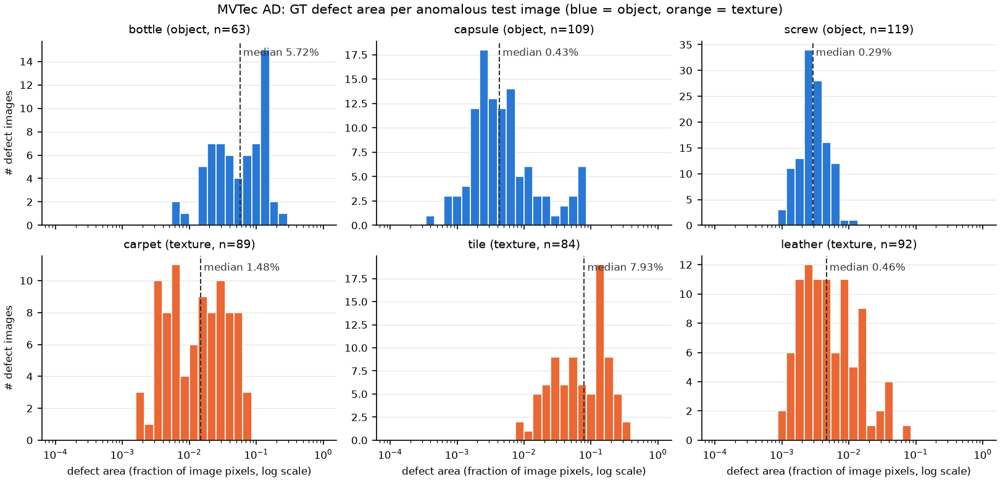
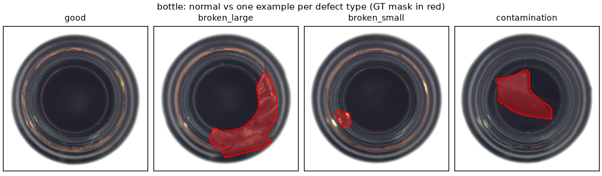
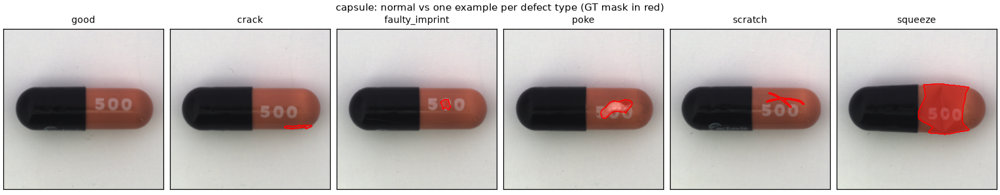
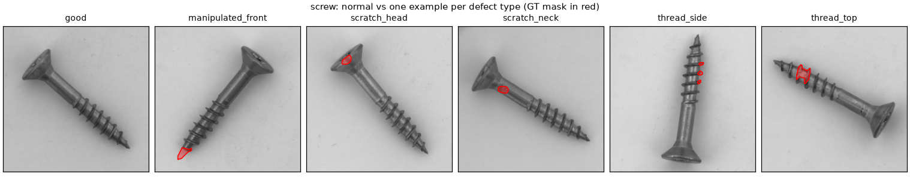
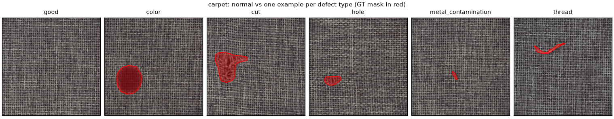
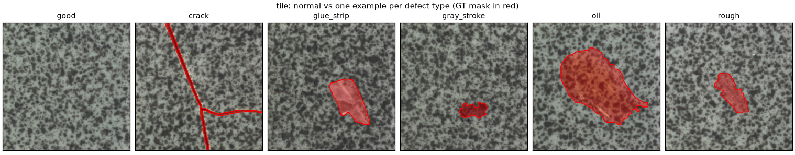
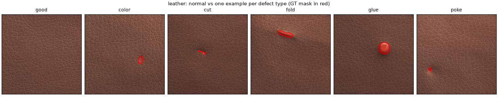

# MVTec AD: dataset analysis (Task 2)

Generated by `scripts/dataset_stats.py`. Data: MVTec AD (Bergmann et al., CVPR 2019; IJCV 2021), licence CC BY-NC-SA 4.0. Categories: bottle, capsule, screw, carpet, tile, leather.

## Overview

`fit / val` is our fixed-seed split of train/good: 90% to fit the model, 10% as the normal-only validation set for thresholds (`ad.data.split_train_val`, seed 0). `pix_std` is the mean per-pixel std over 64x64 grey normal images. `align_corr` is the mean correlation of a normal image with the mean normal image. For objects, high means aligned images with fixed geometry, and low means pose or rotation variation. For textures it mostly reflects shared low-frequency illumination, because the stochastic texture itself is uncorrelated. Both proxies use train/good only.

| category | kind | resolution | train/good | fit / val | test good | test defect | defect types | pix_std | align_corr |
|---|---|---|---|---|---|---|---|---|---|
| bottle | object | 900x900 | 209 | 188 / 21 | 20 | 63 | 3 | 0.022 | 0.996 |
| capsule | object | 1000x1000 | 219 | 197 / 22 | 23 | 109 | 5 | 0.023 | 0.998 |
| screw | object | 1024x1024 | 320 | 288 / 32 | 41 | 119 | 5 | 0.094 | 0.579 |
| carpet | texture | 1024x1024 | 280 | 252 / 28 | 28 | 89 | 5 | 0.058 | 0.200 |
| tile | texture | 840x840 | 230 | 207 / 23 | 33 | 84 | 5 | 0.106 | 0.155 |
| leather | texture | 1024x1024 | 245 | 220 / 25 | 32 | 92 | 5 | 0.022 | 0.880 |

## Defect size and number of regions (anomalous test images, GT masks at original resolution)

Area is the fraction of image pixels inside the GT mask. Regions are 8-connected components of the mask. The full distribution is in `defect_area_hist.png`.

| category | area mean | area median | area min | area max | regions/img mean | regions/img max | imgs with >1 region |
|---|---|---|---|---|---|---|---|
| bottle | 7.62% | 5.72% | 0.576% | 27.42% | 1.08 | 3 | 6% |
| capsule | 1.11% | 0.43% | 0.037% | 8.08% | 1.05 | 3 | 4% |
| screw | 0.34% | 0.29% | 0.099% | 1.01% | 1.13 | 3 | 10% |
| carpet | 2.11% | 1.48% | 0.165% | 8.02% | 1.09 | 3 | 8% |
| tile | 9.80% | 7.93% | 0.842% | 35.49% | 1.02 | 2 | 2% |
| leather | 0.87% | 0.46% | 0.089% | 6.86% | 1.08 | 3 | 5% |

## Test images per defect type

| category | defect type | n test | area median | area min | area max | regions/img mean |
|---|---|---|---|---|---|---|
| bottle | broken_large | 20 | 11.87% | 4.090% | 27.42% | 1.00 |
| bottle | broken_small | 22 | 2.44% | 0.885% | 8.06% | 1.18 |
| bottle | contamination | 21 | 7.25% | 0.576% | 16.53% | 1.05 |
| bottle | good | 20 | - | - | - | - |
| capsule | crack | 23 | 0.30% | 0.037% | 2.33% | 1.00 |
| capsule | faulty_imprint | 22 | 0.28% | 0.142% | 4.13% | 1.00 |
| capsule | good | 23 | - | - | - | - |
| capsule | poke | 21 | 0.23% | 0.069% | 1.23% | 1.05 |
| capsule | scratch | 23 | 0.64% | 0.297% | 1.53% | 1.17 |
| capsule | squeeze | 20 | 2.76% | 0.188% | 8.08% | 1.00 |
| screw | good | 41 | - | - | - | - |
| screw | manipulated_front | 24 | 0.30% | 0.130% | 0.67% | 1.08 |
| screw | scratch_head | 24 | 0.25% | 0.129% | 0.37% | 1.00 |
| screw | scratch_neck | 25 | 0.30% | 0.099% | 0.71% | 1.16 |
| screw | thread_side | 23 | 0.26% | 0.115% | 0.57% | 1.43 |
| screw | thread_top | 23 | 0.52% | 0.111% | 1.01% | 1.00 |
| carpet | color | 19 | 1.57% | 0.350% | 6.27% | 1.16 |
| carpet | cut | 17 | 4.35% | 3.179% | 8.02% | 1.06 |
| carpet | good | 28 | - | - | - | - |
| carpet | hole | 17 | 1.84% | 0.671% | 5.64% | 1.00 |
| carpet | metal_contamination | 17 | 0.39% | 0.165% | 1.35% | 1.06 |
| carpet | thread | 19 | 0.64% | 0.181% | 5.32% | 1.16 |
| tile | crack | 17 | 2.10% | 0.842% | 3.63% | 1.00 |
| tile | glue_strip | 18 | 9.15% | 2.139% | 35.49% | 1.00 |
| tile | good | 33 | - | - | - | - |
| tile | gray_stroke | 16 | 4.24% | 1.804% | 7.06% | 1.00 |
| tile | oil | 18 | 14.04% | 11.676% | 23.50% | 1.00 |
| tile | rough | 15 | 12.36% | 4.090% | 33.14% | 1.13 |
| leather | color | 19 | 0.25% | 0.089% | 1.28% | 1.11 |
| leather | cut | 19 | 0.38% | 0.099% | 1.70% | 1.05 |
| leather | fold | 17 | 1.68% | 0.846% | 6.86% | 1.00 |
| leather | glue | 19 | 0.67% | 0.167% | 1.75% | 1.21 |
| leather | good | 32 | - | - | - | - |
| leather | poke | 18 | 0.23% | 0.153% | 0.40% | 1.00 |

## Category characteristics and expected impact on anomaly detection

**bottle (object).** Bottles are photographed top-down, looking into the opening. The bottle fills most of the frame, is centred on a white background and shows no rotation of note (align_corr = 0.996). Because of the radial symmetry, normal appearance at a given image position is almost the same in every image. This favours per-position Gaussian models like PaDiM, and also suits PatchCore's memory bank. Defects (broken_large, broken_small, contamination) are mid-sized: the median defect area is 5.7% of the image, with 1.1 region(s) per image on average. They are easy to detect at image level. The hard part is localisation along the glossy rim, where specular highlights can raise false positives.

**capsule (object).** A single pill lies horizontally on a plain light background, in the same orientation every time: black cap on the left, '500' imprint on the right. Normal images are as well aligned as bottle (align_corr = 0.998), so per-position models such as PaDiM apply directly. Defects are small and subtle: cracks, pokes, scratches, faulty imprints and squeeze. The median defect area is only 0.43% of the image (min 0.037%). On the 28x28 stride-8 feature grid at 224x224 input, that is about 3 of 784 cells, and the smallest cracks cover less than one cell. So capsule tests the spatial resolution of the features, and Gaussian smoothing can wash small defects out. Squeeze is the exception: a large shape change (median 2.8%) that only shows as a slightly deformed outline. The imprint and logo are normal high-frequency structure, and a faulty_imprint differs from a correct one only in fine detail.

**screw (object).** The screw lies at an arbitrary in-plane rotation and position on a light grey background with a mild illumination gradient. Its normal images are by far the least aligned of the objects (align_corr = 0.58 vs about 1.00 for bottle and capsule; pix_std = 0.094). This breaks PaDiM's assumption that the same position looks the same in every image, because each position sees thread, head or background depending on the rotation. PatchCore's position-agnostic nearest-neighbour memory copes better. Defects such as manipulated_front, scratch_head, scratch_neck, thread_side and thread_top are uniformly tiny: median 0.29%, max 1.01%, the narrowest size range of the six. thread_side defects are often split into several small regions. Screw is reported in the PaDiM and PatchCore papers as one of the hardest MVTec AD categories, and we expect it to be the hardest of the six here.

**carpet (texture).** A woven, stationary texture fills the whole frame. There is no object geometry or background, and alignment is irrelevant (align_corr = 0.20 only shows that the texture is stochastic). Every patch is statistically alike, so a memory of normal patches generalises well and PatchCore can sub-sample it aggressively. Defects (color, cut, hole, metal_contamination, thread) vary in size, with a median of 1.48%. cut defects are the largest (median about 4%), while metal_contamination is the smallest (median about 0.4%) and is easy to miss after downsampling. color defects keep the weave structure intact and change only the hue, so they rely on how well the backbone features encode colour.

**tile (texture).** Ceramic tile with irregular dark-grey blotches on a light grey-green base. Like carpet it is stationary with no meaningful alignment (align_corr = 0.15). Its normal images also vary the most of all six categories (pix_std = 0.106), so the normal distribution is broad and normal speckle clusters can produce false positives. Defects (crack, glue_strip, gray_stroke, oil, rough) are the largest in this study: median 7.9%, max 35%. That makes image-level detection easy. Localisation must still capture the whole extent of oil and glue stains, which are low-contrast at their borders and pull pixel AUPRO down.

**leather (texture).** Fine, uniform grain with no object geometry. Its align_corr is high for a texture (0.88) because every image shares the same smooth illumination fall-off towards the corners, not because the grain is aligned. Pixel variation between normal images is the lowest of the textures (pix_std = 0.022), so most defects (color, cut, fold, glue, poke) stand out clearly against the grain. Defects are small (median 0.46%, min 0.089%). Pokes and colour spots are the smallest, with medians of about 0.2%. Leather is usually close to saturated for pretrained-feature methods. The main failure mode is a slight colour change, which mid-level CNN features are less sensitive to than to structural changes.

### Summary

- **Texture vs object.** Texture categories (carpet, tile, leather) are stationary. Any patch can be compared with any normal patch, so position-agnostic methods (PatchCore) and position-specific ones (PaDiM) both work, and alignment does not matter. Object categories need consistent geometry for PaDiM's per-position statistics. That holds for bottle and capsule, which are both consistently posed, but not for screw, where rotation and position are free.
- **Background variation.** The three object categories are shot on a controlled, uniform background, and the textures fill the frame with no background at all. For objects, most of the image is background, so the decision rests on a small foreground area, and background noise (dust, illumination gradients on screw) can cause false positives. Normal variation is highest for tile and screw (pix_std about 0.1), which makes the learned normal distribution broader and subtle defects harder to separate.
- **Defect size.** Defect area spans about three orders of magnitude, from about 0.04% of the image (smallest capsule crack; leather and screw also go below 0.1%) to 35% (tile glue_strip). Screw, capsule and leather have medians below 0.5%, whereas tile and bottle defects are mostly above 2%. At 224x224 input, one stride-8 WRN50 feature cell covers about 0.13% of the image. Defects near or below that size are diluted by bilinear upsampling and Gaussian smoothing, which lowers both image-level recall and pixel-level overlap. Large defects are easy to detect, but they are harder to segment completely.
- **Multiple regions.** Some images contain several separate defect regions (see the regions columns). AUPRO weights every region equally, so it rewards finding small secondary regions that pixel AUROC barely notices.
