# Curated failure cases (PaDiM vs PatchCore)

Generated by `scripts/analysis_failure_panels.py` from the saved `padim_wrn50` and `patchcore_wrn50` outputs. Columns: image + GT (green); PaDiM map; PatchCore map. Maps are shown as map / normal-validation pixel threshold (shared colour scale 0.4–1.6); red contours = predicted region (map >= pixel threshold). Titles give image score / normal-validation image threshold and the decision. Per-image numbers are in `tables/per_image.csv`.

## 01. screw / thread_top/004.png

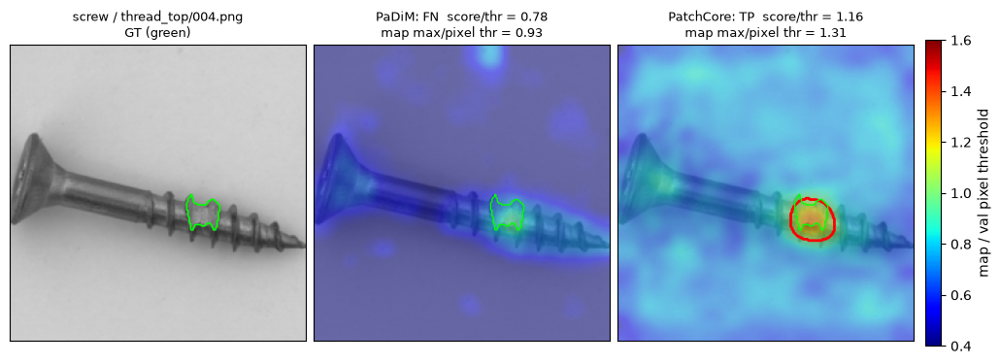

PaDiM FN (score/thr 0.78, map max/pixel thr 0.93); PatchCore TP (score/thr 1.16, map max/pixel thr 1.31).

**Missed only by PaDiM (pose).** The screw lies at an arbitrary rotation, so each PaDiM position Gaussian has to cover thread, shank, head and background seen across the fit images. The damaged thread tip does not stand out against that broad per-position distribution (PaDiM map stays below its pixel threshold everywhere). PatchCore's position-free nearest-neighbour search finds no normal patch like the damaged tip and localises it (pixel IoU 0.45).

## 02. screw / thread_side/004.png

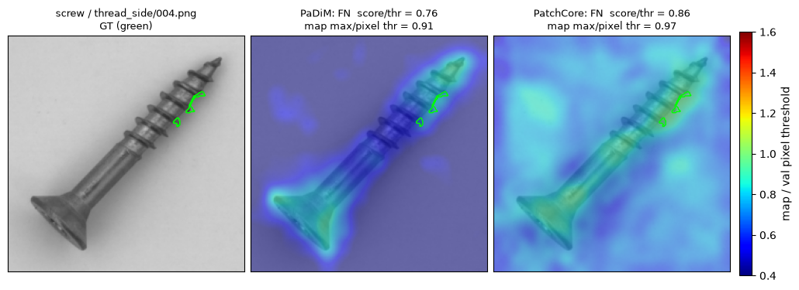

PaDiM FN (score/thr 0.76, map max/pixel thr 0.91); PatchCore FN (score/thr 0.86, map max/pixel thr 0.97).

**Missed by both.** A thread_side defect split into two tiny GT regions (0.14% of the full image) on the thread flank. The thread is high-frequency normal structure; at stride 8 the damaged flank still resembles normal thread patches, so neither map exceeds its pixel threshold inside the GT and both image scores stay below threshold.

## 03. capsule / scratch/017.png

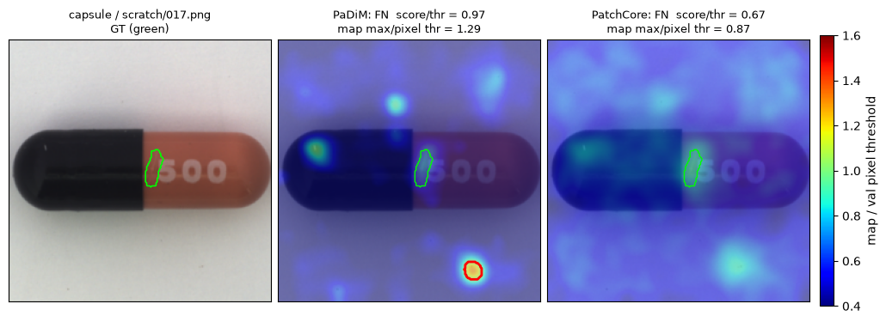

PaDiM FN (score/thr 0.97, map max/pixel thr 1.29); PatchCore FN (score/thr 0.67, map max/pixel thr 0.87).

**Missed by both.** A faint, thin scratch next to the cap/body seam. PatchCore's map is flat (max 0.87x its pixel threshold). PaDiM's only above-threshold blob is a dust speck on the background (bottom right), not the scratch: its tight per-position background Gaussian reacts more to dust than to low-contrast damage on the body.

## 04. capsule / crack/016.png

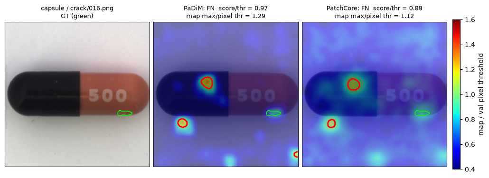

PaDiM FN (score/thr 0.97, map max/pixel thr 1.29); PatchCore FN (score/thr 0.89, map max/pixel thr 1.12).

**Missed by both, peak off-target.** The crack is a thin sliver (0.26% of the crop). Both maps place their maxima on dark specks (one on the black cap, one on the background), which are normal-but-rare appearances, while the crack itself stays below threshold.

## 05. capsule / faulty_imprint/019.png

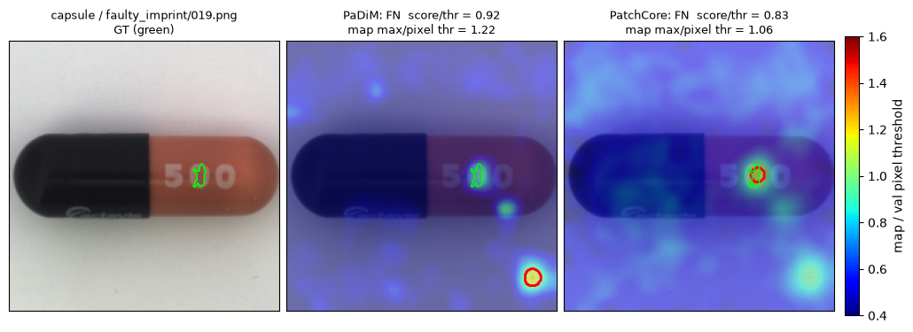

PaDiM FN (score/thr 0.92, map max/pixel thr 1.22); PatchCore FN (score/thr 0.83, map max/pixel thr 1.06).

**PatchCore near-miss: localised but not detected.** PatchCore's map exceeds its pixel threshold exactly on the damaged '5' (pixel IoU 0.45), but its Eq. 7 image score is only 0.83x the image threshold. Pixel and image thresholds are calibrated separately on normal val data, and capsule has PatchCore's widest normal val score spread (image threshold 1.58x the val median), so a pixel-level hit need not cross the image threshold. PaDiM's strongest response is again a background speck.

## 06. tile / gray_stroke/012.png

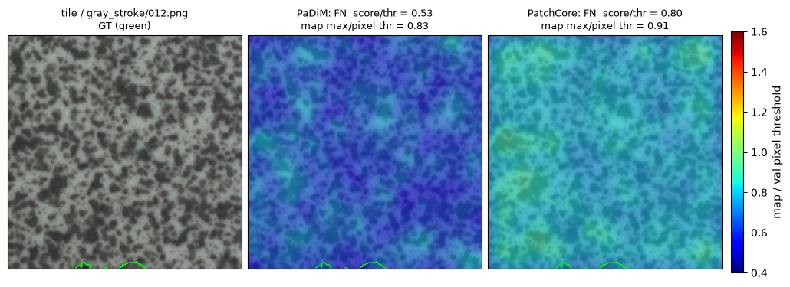

PaDiM FN (score/thr 0.53, map max/pixel thr 0.83); PatchCore FN (score/thr 0.80, map max/pixel thr 0.91).

**Missed by both: defect cut away by preprocessing.** The resize-256 / centre-crop-224 step keeps only ~10% of this gray_stroke's GT; what remains is a sliver at the bottom edge. The two lowest-scoring PatchCore tile misses (gray_stroke 012 and 002) are both crop-truncated. The tile maps also show how close normal dark blotches score to the threshold.

## 07. tile / oil/000.png

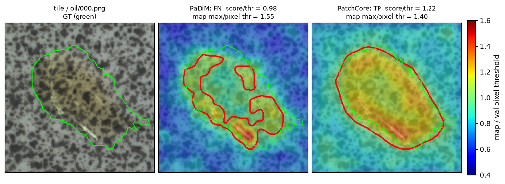

PaDiM FN (score/thr 0.98, map max/pixel thr 1.55); PatchCore TP (score/thr 1.22, map max/pixel thr 1.40).

**PaDiM threshold failure, not a ranking failure.** PaDiM's map clearly highlights the oil stain (map max 1.55x the pixel threshold, peak inside GT), yet the image score is 0.98x PaDiM's image threshold. That threshold (29.8) is driven by one extreme normal val image (val max 31.3 vs second-largest 24.4). PatchCore detects and segments it (IoU 0.85).

## 08. carpet / good/012.png

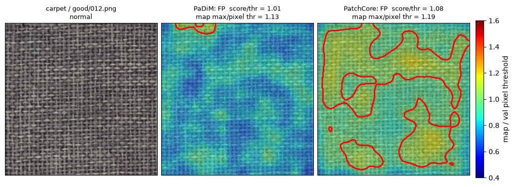

PaDiM FP (score/thr 1.01, map max/pixel thr 1.13); PatchCore FP (score/thr 1.08, map max/pixel thr 1.19).

**False positive from a global shift (both methods, mostly PatchCore).** No local hotspot: PatchCore's map is raised almost everywhere and 42% of pixels exceed its pixel threshold. Normal test carpet scores sit above the normal val scores (median 1.112 vs 1.061), while PatchCore's val spread on carpet is very tight, so the 99% val quantile leaves little margin. 10 of 28 normal carpets are flagged.

## 09. leather / good/024.png

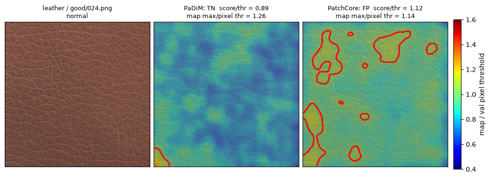

PaDiM TN (score/thr 0.89, map max/pixel thr 1.26); PatchCore FP (score/thr 1.12, map max/pixel thr 1.14).

**PatchCore false positive on normal leather.** No visible defect. The map is mildly raised with scattered above-threshold blobs, the largest at the left border. As on carpet, normal test leather scores higher than normal val (PatchCore median 1.070 vs 0.968) and the val spread is tight; PaDiM sees a similar shift but its looser threshold absorbs it.

## 10. capsule / good/006.png

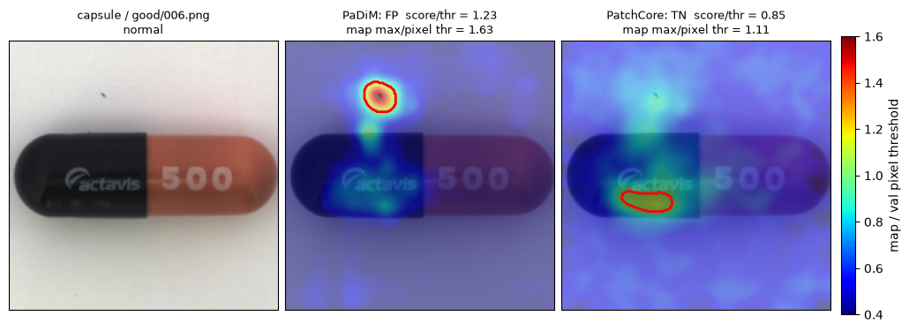

PaDiM FP (score/thr 1.23, map max/pixel thr 1.63); PatchCore TN (score/thr 0.85, map max/pixel thr 1.11).

**PaDiM-only false positive: dust on the background.** A small dark speck above the capsule. PaDiM models each background position with a very tight Gaussian, so any speck is a large Mahalanobis outlier (score 1.23x threshold). PatchCore also responds weakly but stays below its image threshold.

## 11. bottle / good/015.png

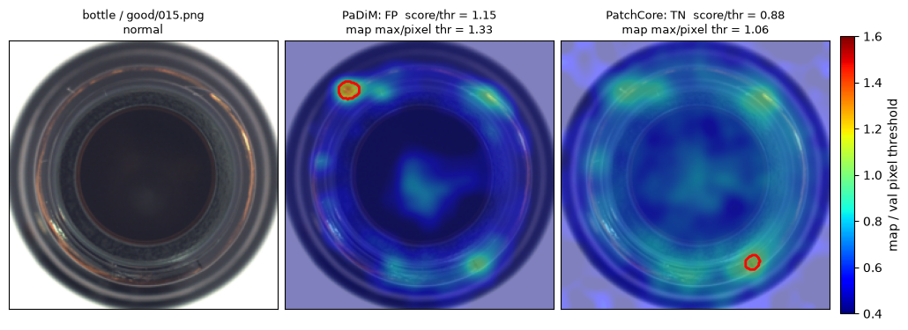

PaDiM FP (score/thr 1.15, map max/pixel thr 1.33); PatchCore TN (score/thr 0.88, map max/pixel thr 1.06).

**PaDiM-only false positive on the rim.** A small bright spot on the upper-left of the glossy rim exceeds PaDiM's tight bottle threshold. The dataset analysis anticipated this: the rim's specular structure is where bottle false alarms arise. PatchCore stays below threshold.

## 12. leather / color/009.png

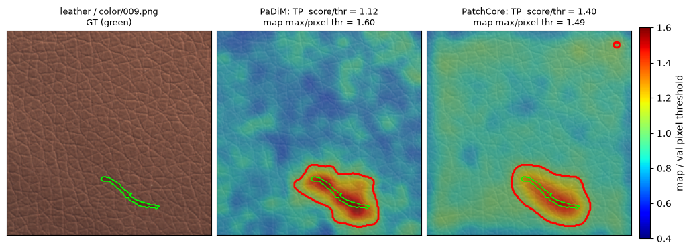

PaDiM TP (score/thr 1.12, map max/pixel thr 1.60); PatchCore TP (score/thr 1.40, map max/pixel thr 1.49).

**True positive with poor localisation.** Both methods detect the image and peak on the defect, but the thin colour streak becomes a blob several times wider after the stride-8 feature grid, bilinear upsampling and sigma=4 smoothing: pixel IoU is 0.07 for both. This is why leather has the lowest median TP IoU despite perfect image recall.
